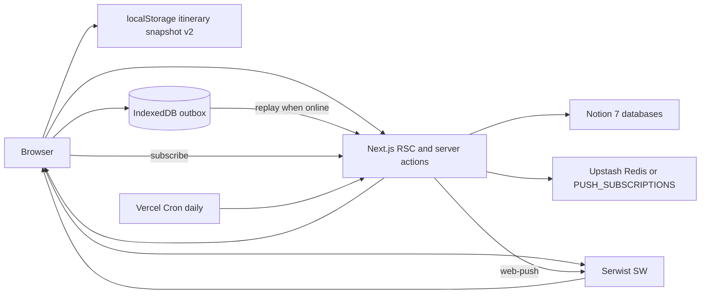

# 000 — Architecture snapshot

- **Repo:** `o000o_active/japan_trip_app` (GitHub: `noowxela/japan-trip`)
- **Status:** current
- **Date:** 2026-10-27
- **Not this document:** workspace `spec001.md` is a backlog idea (Firebase, journal, boarding-pass bookings). Live source of truth is **Notion**.

## What it is

Mobile-first itinerary companion PWA. Notion holds trip data; this Next.js app is the on-the-go UI (schedule, map, spend, prep). Version from `package.json`.

## Stack

| Layer | Choice |
| --- | --- |
| App | Next.js 16.3 App Router, React 19, TypeScript, Tailwind 4 |
| Deploy | Vercel (`@vercel/analytics`, `@vercel/speed-insights`) |
| Data | `@notionhq/client` v5, API `2025-09-03`, `dataSources.query` |
| Maps | Leaflet + react-leaflet; geocode via Nominatim + landmark table |
| FX | Live MYR→JPY with static fallback `JPY_PER_RM` (39.3) |
| Test | Vitest 3 (`npm test`); pure-logic unit tests under `src/lib/*.test.ts` |
| CI | `.github/workflows/ci.yml` — lint, typecheck, test on push/PR (Node 22, no Notion secrets) |
| PWA | `src/app/manifest.ts` (`start_url: /`, standalone). Serwist (`@serwist/turbopack`) SW at `/serwist/sw.js` (production only; disabled in `next dev`). Offline: navigation/runtime caches + localStorage itinerary snapshot v2 + IndexedDB outbox. Web Push: `web-push` + SW `push`/`notificationclick` (same-origin focus + navigate try/catch); daily cron `/api/cron/reminders` (11:00 UTC; dry-run `?dry=1&now=`); subs in Upstash Redis REST or `PUSH_SUBSCRIPTIONS` env (not Notion). Env vars listed in README — do not rely on `.env.example` for push keys |

Setup: `npm run setup:notion` then `npm run migrate:v2`. IDs land in `.env.local` (`NOTION_*_DS`).

## Data flow

- **Read:** server components call cached getters in `src/lib/trip.ts` → `src/lib/notion.ts` `queryAll()`.
- **Write (online):** forms → `src/app/actions.ts` → Notion `pages.create` / `update` → `revalidatePath` / `updateTag`.
- **Offline read:** Serwist caches visited documents/assets; `TripCacheSync` writes days/places/transit/stays/spend/prep to `japan-trip-itinerary-v1` (content `v: 2`). Schedule, `/phrases` (stays for hotel cards), and `/~offline` can fall back from the snapshot. Pages that fail to reach Notion while online keep existing fallbacks. Phrase deck data is bundled in `src/lib/phrases.ts` (no Notion). `useSyncExternalStore` readers for trip cache + custom phrases memoize by raw localStorage string (stable snapshot refs; React #185).
- **Offline write:** client wrappers enqueue `toggleVisited` / `addSpend` / `togglePrep` into IndexedDB (`japan-trip` / `outbox`), apply optimistic UI, replay on `online` / app start / every 30s. Toggles send desired state; spend uses `clientId` + `createdAt` for idempotency.

Pages are `export const dynamic = "force-dynamic"`. No webhooks, no poll, no multi-device conflict UI.

## Notion databases

| Env | Role |
| --- | --- |
| `NOTION_DAYS_DS` | Trip days (date, city, status) |
| `NOTION_PLACES_DS` | Stops (type, start, lat/lng, visited, pending) |
| `NOTION_STAYS_DS` | Hotels (check-in/out, address) |
| `NOTION_TRANSIT_DS` | Legs (mode, from/to, start) |
| `NOTION_SPEND_DS` | Expenses (Yen/RM, category, paid by) |
| `NOTION_EDITORS_DS` | Optional editor name + PIN |
| `NOTION_PREP_DS` | Optional packing/checklist |

Canonical schema: `notion/src/main.ts`. CLI fallbacks: `notion/scripts/`.

## Surfaces

Bottom nav (`src/components/bottom-nav.tsx`): Overview `/`, Schedule `/schedule` (hides nav), Map `/map`, Expenses `/budget`, More `/settings`. Labels follow `lang` cookie (default zh).

Primary day UI is unified Schedule: `/schedule?day=<id|today>&mode=<now|edit>`. Redirects: `/today` → `day=today&mode=now`, `/days/:id` → `day=:id`. `/days` list remains under More.

Secondary: `/map`, `/lists`, `/places`, `/stays`, `/transit`, `/days`, `/prep`, `/phrases` (bundled Japanese phrase cards + hotel address cards from stays; custom phrases in localStorage). `/spend` redirects to `/budget`. Offline shell: `/~offline`. `/phrases` is also in Serwist `additionalPrecacheEntries`.

i18n: `src/lib/i18n/dictionaries.ts` + `getLocale()` (`lang` cookie) + `I18nProvider` / `useT()`.

Theme: cookie `theme` (`system` \| `light` \| `dark`) via `getThemePreference()` / `setTheme`; root `<html data-theme>` + head boot script for system/`prefers-color-scheme`. Semantic tokens in `src/app/globals.css` (`accent`, `ok`, `maybe`, `transit`, `ink`, `surface`, `canvas`, …). Maps auto-resolve Dark tiles when app is dark unless user saved a style (`src/lib/map-styles.ts` — OSM Streets + Esri Soft/Light/Dark/Sat; optional label overlays). `/map` is full-bleed with a city→day sheet (mobile bottom snaps; desktop ~360px left panel); trip pins use day-coloured D{n} badges; zoom sits under Layers. Schedule/Budget/Map densified in SDD 008; remaining list/overview/settings/prep/offline surfaces share the same compact row language via `src/components/compact/*` (SDD 009). Toasts sit above the tab bar; reversible deletes use `restorePage` + Undo. SyncBadge also shows a top banner for offline / Notion-fail cache.

## Auth

Viewers: no login; anyone with the deployed URL can **read**. Editors: PIN in Notion Editors DB; HMAC-signed httpOnly cookie `trip_editor` (14 days, secret = `NOTION_TOKEN`). Gating is in server actions (`requireEditor`), not middleware. If Editors DB is unset, everyone can edit. Outbox replay respects the same gate (keeps entry if editor cookie missing).

## Key modules

| Path | Role |
| --- | --- |
| `src/lib/notion.ts` | Client, query, property parsers |
| `src/lib/trip.ts` | Fetch + parse entities |
| `src/lib/trip-core.ts` | Agenda / focus-day (pure) |
| `src/app/actions.ts` | All mutations |
| `src/lib/edit-session.ts` | PIN cookie |
| `src/lib/trip-cache.ts` | localStorage snapshot v2 |
| `src/lib/outbox-core.ts` / `outbox.ts` | Outbox pure logic + IndexedDB I/O |
| `src/app/sw.ts` | Serwist service worker (+ push / notificationclick) |
| `src/lib/reminders.ts` | Pure evening-before reminder planner (Tokyo) |
| `src/lib/push-store.ts` / `push.ts` | Subscription store + `web-push` send |
| `src/app/api/push/*` / `api/cron/reminders` | Subscribe / test / daily cron |
| `src/lib/spend.ts` / `exchange.ts` | Budget math and FX |
| `src/lib/geocode.ts` | Nominatim + landmarks |
| `src/lib/theme.ts` / `theme-server.ts` | Appearance cookie + boot script |
| `src/app/globals.css` | Semantic color/type/card tokens + dark |
| `src/components/hanko-stamp.tsx` | Hanko stamp (Now / 済) |
| `src/lib/city-kanji.ts` | Tokyo/Kyoto/Osaka/Nara kanji |
| `src/components/quick-expense-provider.tsx` | Global `openQuickExpense` + sheet (outbox spend + Undo) |
| `src/components/chip-group.tsx` | Shared compact radio chips for short option lists |
| `src/components/compact/*` | Shared Schedule-density primitives (PageHeader, CompactRow, ChipRow, SummaryStrip, ActionSheet) |
| `src/components/unlock-provider.tsx` | Unlock sheet; viewers tapping edit open PIN UI |
| `src/components/map-tiles.tsx` | Base + optional overlay TileLayers for map styles |
| `src/components/cache-fallback.tsx` | Marks Notion-fail → cache UI for SyncBadge banner |
| `src/components/timeline-skeleton.tsx` | Timeline-shaped loading skeletons |

## Pros

- Notion is the CMS: bulk edits and photos stay in Notion; the app stays thin.
- Single Vercel deploy; no app database to operate.
- Strong on-trip UX: schedule + map sheet, MYR/Yen spend, editor PIN for a small group.
- Offline: visited shells + full itinerary snapshot + queued visited/spend/prep writes.

## Cons / risks

- Every page hits Notion when online; latency and rate limits; no realtime sync.
- Soft security: token on the server exposes all trip data; PIN is readable Notion text; mutations gated, reads are not.
- Pure-logic unit tests only (no E2E / Notion integration). `src/app/actions.ts` is a single large mutations file.
- Geocoding and FX depend on public APIs.
- Offline HTML/RSC freshness depends on prior online visits; outbox can stall without editor unlock.

## Do not change in this snapshot

Firebase, journal tab, boarding-pass booking UI. Those need a numbered change SDD after questions and approval.

Offline SW + outbox: see [004](sdd/004-offline-mode.md) (supersedes the previous “no service-worker offline writes” freeze).
