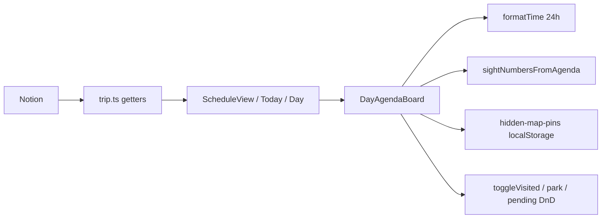

# SDD: Schedule visual polish

- **Repo:** `o000o_active/japan_trip_app`
- **Status:** `implemented`
- **Date:** 2026-10-27
- **Related:** [architecture](../architecture.md), surfaces Schedule `/schedule`, Today `/today`, Day `/days/[id]` (shared `DayAgendaBoard`)

## 1. Context / current architecture

Schedule is a map + bottom sheet (`schedule-view.tsx`) with day tabs (`schedule-day-tabs.tsx`) and a scrollable agenda pane that renders `DayAgendaBoard`. The same board is reused on `/today` and `/days/[id]`.

Today’s board:

- Rows mix place cards and transit cards with the same white-card chrome.
- Place name shares a line with hide-pin, Maps pin, Route, and `…` (names wrap; controls look alike).
- Times use `formatTimeAmPm` (12h) in a `w-16` column; Overview already uses 24h `formatTime`.
- Timeline marks mix numbered badges, coloured dots, and sizes; vertical line uses an offset, not the marker column centre.
- Gap/walk rows use green + CSS `uppercase`.
- Day header: title + green hotel chip + grey “Full day →” pill on one row.
- Day tabs: `M/D` + “Day n” / “Today”; no weekday.
- Agenda pane bottom padding (~1.5rem) leaves the fixed Overview pill covering the last card.
- Tokens live in `globals.css` (paper, hanko/moss `#b42318`, stone, Nunito). No dark mode.

Out of scope for restyle (must keep working): `PendingPanel`, `CarryOverBanner`, drag handlers, sight-number map sync, FAB/quick-add if present, sheet drag, map fullscreen, top back control.

## 2. Problem and non-goals

**Problem:** The schedule agenda reads as a dense control strip rather than a timeline. Times disagree with Overview, transit and gaps shout as hard as places, and the Overview pill occludes the last stop.

**Non-goals:**

- No git writes, no `npm install` / `package.json`, no `.env*`, no `notion/`, no Notion API, no `next dev` / build.
- No new design system or dependencies; no dark mode.
- Do not restyle PendingPanel / CarryOverBanner beyond keeping them functional.
- Do not change day-tab scroll/snap/measure/motion logic or `TAB_WIDTH_PX` unless width must change for the two-line tab (then keep motion math consistent).
- Keep `formatTimeAmPm` exported (other callers may use it); stop using it on this board.
- Orange `#ea580c` only as the food marker colour.

## 3. Questions asked and answers

| Question | Answer |
| --- | --- |
| Spec already defines layout, tokens, markers, menu, padding, and file scope — any open product choice? | None; implement exactly as target design below (from the request). |
| Restyle PendingPanel / CarryOverBanner? | No — keep working only. |

## 4. Proposed approach, pros / cons, rejected alternatives

**Approach:** CSS/structure polish in the listed components + small format helpers. Behaviour stays; chrome changes.

| File | Change |
| --- | --- |
| `day-agenda-board.tsx` | 3-col timeline grid; unified `TimelineMark`; place card layout; transit as connector (not card); quiet gap row; 24h time; `…` for all users with hide/show map in Modal; drop indicators |
| `schedule-view.tsx` | Sticky day header; title + `formatDay` + city subline; hanko “Full day” text link; StayLocationBadge quiet row; pane padding; Overview pill style; `max-w-2xl` when single-column agenda |
| `schedule-day-tabs.tsx` | Two-line tabs (weekday + date num); today = hanko 4px dot; All / days; ≥44px tall; subtle bottom border — no scroll/snap/motion edits |
| `format.ts` | Add `formatTabWeekday` (same `T12:00:00` local trick as `formatTabDate`) if needed |
| `maps-pin-link.tsx` / `directions-link.tsx` | Optional `variant="text"` for Map / Route action row; default unchanged for Overview/Today cards |

**Pros:**

- Aligns Schedule with Overview time format and existing tokens without a redesign system.
- Shared board improves `/today` and `/days/[id]` at the same time.
- Hides pin chrome into `…` frees the name line; map visibility stays available to viewers.

**Cons / risks:**

- Shared board means Today/Day detail pick up the new look — intentional, but verify those pages still feel right.
- Moving hide-pin into the menu adds a tap for a frequent map action; mitigated by “Hidden on map” on line 2.
- Tab content change at fixed `TAB_WIDTH_PX` (56) may feel tight with weekday + number + dot; bump width only if necessary and keep motion distance keyed off the same constant.

**Rejected alternatives:**

| Alternative | Why not |
| --- | --- |
| Separate Schedule-only board fork | Duplicates drag/visited/park logic; Today/Day would stay ugly |
| New icon/button DS or shadow elevation system | Violates “reuse tokens / no new design system” |
| Keep 12h on board | Conflicts with Overview and the brief |

**Picture:**

UI — Schedule sheet (mobile ~390px), scroll agenda under sticky header:

```text
+------------------------------------------+
| [==== drag handle ====]                  |
|  All   Mon  Tue* Wed  Thu …   (* = dot)  |
|------------------------------------------|
| Sticky: Day title              Full day ›|
|         Tue 27 Oct · Tokyo               |
|         🛏 Hotel name  [eye]              |
|------------------------------------------|
| 09:00  (1)  Place name              […]  |
|             Sight · notes…               |
|             [Map] [Route]                |
|        ○    Metro  Leg name              |
|             Station A → Station B        |
|        ·    2h 30m free · 4 min walk     |
| 14:00  (2)  Next place              […]  |
| …                                        |
|                          [‹ Overview]    |
+------------------------------------------+
User: scrolls agenda → sticky title stays; taps […] → Hide/Show on map (+ editor actions); taps Overview pill → /.
```

Function — presentation only; data paths unchanged:



## 5. Acceptance criteria and verification

- [x] Board times are 24h via `formatTime`; untimed show "—"; no `formatTimeAmPm` import in `day-agenda-board`.
- [x] Each agenda `<li>` is time (`w-11` tabular) | 24px marker column with continuous `bg-stone-200` 1px line | content.
- [x] Markers match spec (sight number / food orange / hanko / hollow transit / visited check); food orange only as marker.
- [x] Place cards: name full width + `…`; muted type · notes; Map/Route text actions only when unvisited; visited muted + strikethrough, no actions.
- [x] `…` visible for all users; first modal item hide/show map when coords; editor gates for visited/park unchanged; “Hidden on map” on line 2 when hidden.
- [x] Transit = connector row (not white card); gaps = sentence-case muted divider (no uppercase/green).
- [x] DnD before-item and end drop zones still work; before-drop = 2px hanko line + small label; end zone invisible until drag-over.
- [x] Schedule header sticky; Full day hanko text link; StayLocationBadge quiet row; pane `pb-[calc(env(safe-area-inset-bottom,0px)+5.5rem)]`; Overview pill restyled; lg agenda `max-w-2xl` when single column.
- [x] Day tabs: weekday + date number; today hanko dot; All / days; ≥44px; scroll/snap/motion preserved.
- [x] `npx tsc --noEmit --incremental false` clean; `npx eslint` on changed files clean.
- [x] Verify: no browser run (HARD RULE: no `next dev`/build). Evidence: `npx tsc --noEmit --incremental false` exit 0; `npx eslint` on the six changed files exit 0; code review of DnD handlers, menu gates, and hide-pin path.

## 6. Status history

| Date | Status | Note |
| --- | --- | --- |
| 2026-10-27 | draft | Spec from visual-polish request; awaiting approval |
| 2026-10-27 | approved | Owner (Alex) go / lgtm — implement now |
| 2026-10-27 | implemented | Visual polish shipped; tsc + eslint clean; no browser verify (no-dev-server rule) |
