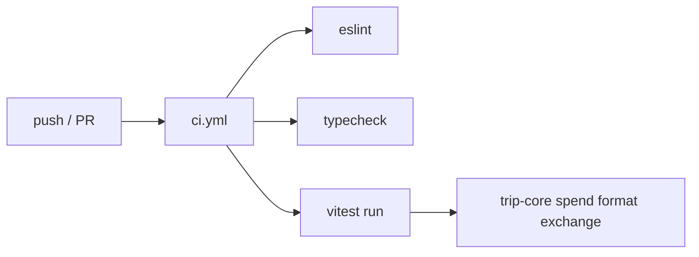

# SDD: Tests + CI + clean lint

- **Repo:** `o000o_active/japan_trip_app`
- **Status:** `implemented`
- **Date:** 2026-10-27
- **Related:** [docs/architecture.md](../architecture.md), [001-schedule-visual-polish](001-schedule-visual-polish.md)

## 1. Context / current architecture

Next.js 16 App Router itinerary companion. Pure trip math lives in `src/lib/trip-core.ts`, `spend.ts`, `format.ts`, `exchange.ts`. Mutations are server actions; Notion is the data store. Architecture notes there are **no automated tests**. Lint currently reports 15 errors + 4 warnings (react-hooks error-boundaries / set-state-in-effect / refs, unused vars, exhaustive-deps). CI only has `.github/workflows/bump-version.yml` (version bump on main).

## 2. Problem and non-goals

**Problem:** No unit tests or CI gate for lint/typecheck/test; eslint is dirty, so regressions land unchecked.

**Non-goals:** E2E / Playwright; Notion API integration tests; changing production behaviour except genuine lint-driven restructures that preserve behaviour; new deps other than vitest; touching `notion/`, `.env*`, or `bump-version.yml`.

## 3. Questions asked and answers

| Question | Answer |
| --- | --- |
| Owner approval for immediate implement? | Yes — Alex approved "Tests + CI + clean lint"; status starts `approved`. |
| New packages? | Only `vitest` (`npm i -D vitest`). |

## 4. Proposed approach, pros / cons, rejected alternatives

**Approach:**

1. Add Vitest with `@` alias (`vitest.config.mts`), restore `trip-core` tests from backup, add cheap pure-logic tests for spend / format / exchange (mock `fetch` if covering `getMyrToJpy` fallbacks).
2. Scripts: `test` = `vitest run`, `typecheck` = `tsc --noEmit`.
3. CI workflow: push + pull_request, Node 22, `npm ci` → lint → typecheck → test; concurrency cancel-in-progress; no secrets.
4. Fix all eslint findings properly (no disable comments; optional ignores only for build artefacts already covered).

**Pros:** Fast pure-logic coverage; CI without Notion secrets; lint patterns match React docs.

**Cons / risks:** Modal / offline / nav restructures must keep animation and SSR hydration behaviour; day-map must keep key-based fit (avoid zoom reset on label re-renders).

**Rejected alternatives:**

| Alternative | Why not |
| --- | --- |
| eslint-disable / rule weakening | Forbidden; hides real issues |
| Jest / Playwright | Extra deps; out of scope |
| Networked FX tests | Must not hit the network |

**Picture:** none — tooling / CI / lint hygiene; no UI surface change intended.

## 5. Acceptance criteria and verification

- [x] SDD `002` approved and indexed
- [x] `src/lib/trip-core.test.ts` + `vitest.config.mts` + spend/format/exchange tests
- [x] `package.json` scripts `test` / `typecheck`; vitest `3.2.4` (v5 peer on `@types/node`/`vite` blocked without extra deps; v3 pulls `vite` transitively)
- [x] `.github/workflows/ci.yml` as specified
- [x] `npx eslint .` → 0 errors, 0 warnings
- [x] `npx tsc --noEmit --incremental false`, `npm test` — 23 tests passed
- [x] No git writes; no Notion API; no `.env*` / `notion/` / bump-version edits

## 6. Status history

| Date | Status | Note |
| --- | --- | --- |
| 2026-10-27 | approved | Owner pre-approved; implement immediately |
| 2026-10-27 | implemented | eslint/tsc/test green locally |
