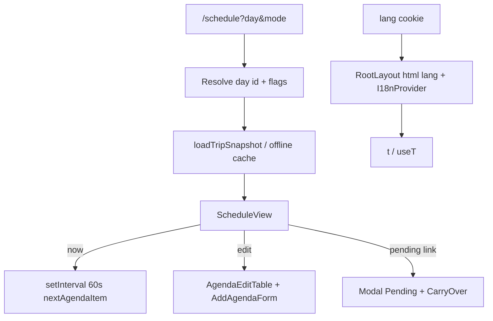

# SDD: Unified Schedule + Chinese UI

- **Repo:** `o000o_active/japan_trip_app`
- **Status:** `implemented`
- **Date:** 2026-10-27
- **Related:** [architecture](../architecture.md), [001 schedule polish](001-schedule-visual-polish.md), [002 tests/CI](002-tests-ci-lint.md)

## 1. Context / current architecture

Three day surfaces exist today:

| Route | Role |
| --- | --- |
| `/today` | Focus day + Now/Up next card + carry-over banners + `DayAgendaBoard` + `DayQuickFab` |
| `/days/[id]` | Full day: map, pending, edit mode (`AgendaEditTable` + `AddAgendaForm`), FAB |
| `/schedule` | Map sheet + day tabs + timeline (`showPending={false}`); “Full day” links out |

Shared pieces: `DayAgendaBoard`, `nextAgendaItem` / `pickFocusDay` / `tripPhase` in `trip-core.ts`, schedule props from `schedule-pins.ts` + `loadTripSnapshot()`. Bottom nav Schedule tab already points at `/schedule` but still matches `/today` and `/days/*`. UI copy is English throughout. No i18n layer.

## 2. Problem and non-goals

**Problem:** On-trip users bounce between Today / Schedule / Day detail. Pending chrome is noisy on schedule. Default language should be Simplified Chinese with an English toggle.

**Non-goals:**

- No git writes, no new npm deps, no `.env*`, no `notion/`, no Notion API, no starting/killing `next dev`.
- Do not remove `/days` list (More). Do not regress 001 timeline/tabs/header polish.
- Do not build a full i18n framework (ICU, plural rules engines, route-based locales).
- Do not translate user/Notion data (place names, notes, day names, raw select values stored); optional display map for known types/modes only.

## 3. Questions asked and answers

| Question | Answer |
| --- | --- |
| Merge approach and Chinese default? | Owner approved: one Schedule with Now + edit + quiet pending sheet; zh default via `lang` cookie. |
| Implement immediately? | Yes — status starts `approved`; do not wait for another approval gate. |

## 4. Proposed approach, pros / cons, rejected alternatives

**Approach:**

1. **URL:** `/schedule?day=<id|today>&mode=<now|edit>`. Default bare `/schedule` during trip ≡ `day=today&mode=now`; otherwise keep focus-day pick. `day=today`: before→first day, during→today’s day, after→last day (no Now).
2. **Redirects** in `next.config.ts` (`permanent: false`): `/today` → `/schedule?day=today&mode=now`; `/days/:id` → `/schedule?day=:id`. Delete `/today` and `/days/[id]` (+ loading). Update internal links; remove Today from More; Schedule tab → `/schedule`.
3. **Now mode** (selected day is Tokyo today, trip during / mode=now): compact “现在” card; one-shot scrollIntoView; hanko highlight; passed items muted; recompute every 60s client-side.
4. **Pending:** quiet “{n} 个待定” header link → Modal with `PendingPanel` + `CarryOverBanner` only.
5. **Edit mode** (editors): “编辑”/“完成” toggles `mode=edit` via `router.replace`; show editors; keep `DayQuickFab` bottom-right in view mode.
6. **i18n:** tiny `dictionaries` + `t()` + cookie `lang` + `I18nProvider` / `useT()`; More language toggle; `html lang` + zh metadata.

**Pros:** One on-trip surface; redirects keep bookmarks; no new deps; zh-first without splitting routes.

**Cons / risks:** `schedule-view.tsx` grows; large string migration; format helpers need locale params (tests pass `"en"` where asserting English).

**Rejected alternatives:**

| Alternative | Why not |
| --- | --- |
| Keep `/today` as thin wrapper | Still three mental models |
| next-intl / similar | New dependency forbidden |
| Hard-delete old URLs without redirects | Breaks bookmarks / More links |

**Picture:**

UI — Schedule sheet, Now mode on today’s day:

```text
+----------------------------------+
| [map]                  [cached?] |
+----------------------------------+
| ===== sheet handle =====         |
| [All] [Tue 27•] [Wed 28] ...     |
|----------------------------------|
| Day name              编辑  3待定›|
| 10月27日 周二 · Tokyo            |
|----------------------------------|
| [现在] 14:30  Place · Map Route  |  ← compact now card
|  … muted past stop …             |
|  ★ current (hanko ring/bg)       |  ← auto-scrolled once
|  next stop                       |
+----------------------------------+
| Overview pill (BL)   FAB (BR)    |
+----------------------------------+
User: taps 编辑 → timeline replaced by AgendaEditTable + AddAgendaForm
User: taps n待定 → bottom Modal with PendingPanel + CarryOver
```

Function:



## 5. Acceptance criteria and verification

- [x] `/today` and `/days/:id` redirect; `/days` list unchanged; More has no Today; Schedule tab active on `/schedule`
- [x] Now / pending sheet / edit mode behave as above; 001 visuals intact
- [x] zh default UI; English toggle via cookie; known type/mode labels mapped for display only
- [x] `npx tsc --noEmit --incremental false`, `npx eslint .` (0 warn/error), `npm test` pass

Evidence: `tsc` clean after clearing stale `.next/types`; `eslint .` 0/0; `npm test` 25 passed. Browser/device Now-mode scroll + pending sheet not exercised in this agent session (no `next dev`).

## 6. Status history

| Date | Status | Note |
| --- | --- | --- |
| 2026-10-27 | approved | Owner Alex: merge three day views + Chinese UI; implement immediately |
| 2026-10-27 | implemented | Unified `/schedule` + zh/en i18n; redirects; tests/lint/tsc green |
