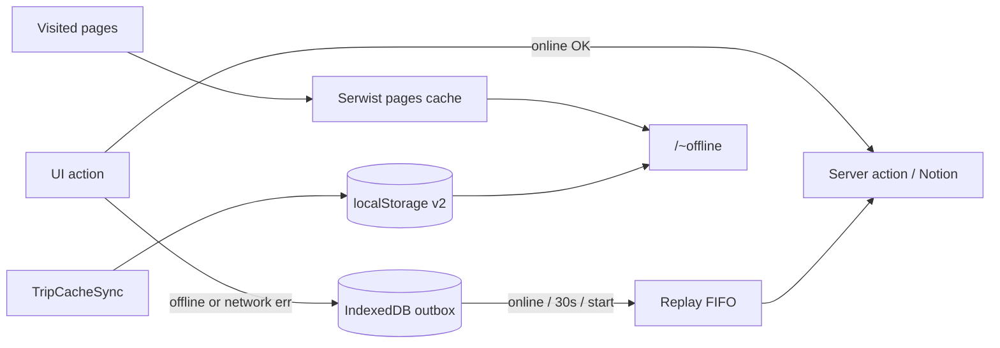

# SDD: Offline mode (service worker + snapshot + outbox)

- **Repo:** `o000o_active/japan_trip_app`
- **Status:** `implemented`
- **Date:** 2026-10-27
- **Related:** [architecture](../architecture.md), [003 unified schedule](003-unified-schedule-zh.md)

## 1. Context / current architecture

PWA has `manifest.ts` but **no service worker**. `AppUpdateProvider` unregisters any SW and deletes all caches on “update”. `TripCacheSync` writes a **v1** localStorage snapshot (`days` / `places` / `transit` / `stays` only) used by `ScheduleOfflineFallback` when Notion fails. Spend and prep are not cached. Mutations always call server actions live; there is no offline write queue. `toggleVisited` / `togglePrepItem` already take desired state (`visited` / `done` bools).

## 2. Problem and non-goals

**Problem:** On the subway (no signal), the installed PWA should still open visited pages and show a useful itinerary; a few common writes (visited, spend, prep) should queue and replay when back online.

**Non-goals:**

- Full CRDT / multi-device conflict UI; journal/Firebase; caching arbitrary POSTs or Notion API in the SW.
- New deps beyond `@serwist/turbopack`, `serwist`, `esbuild`; no `idb` / `fake-indexeddb`.
- No git writes, no `.env*`, no `notion/` scripts, no Notion API from the agent, no starting/killing `next dev`.

## 3. Questions asked and answers

| Question | Answer |
| --- | --- |
| Scope and stack? | Owner approved: Serwist (Turbopack) SW + snapshot v2 + IndexedDB outbox for three write kinds. |
| Implement immediately? | Yes — status starts `approved`; supersedes architecture “do not change: service-worker offline writes”. |

## 4. Proposed approach, pros / cons, rejected alternatives

**Approach:**

1. **Serwist:** `withSerwist` in `next.config.ts`; route `src/app/serwist/[path]/route.ts` via `createSerwistRoute({ swSrc: "src/app/sw.ts", useNativeEsbuild: true, additionalPrecacheEntries: [{ url: "/~offline", revision }] })`; SW registers at `/serwist/sw.js` through a `"use client"` re-export of `SerwistProvider`, **disabled in development**.
2. **Runtime cache:** `defaultCache` + NetworkFirst (~4s) for same-origin `navigate` into `pages`; NetworkOnly for POST / `/api/version` / `/serwist/*`; document fallback `/~offline`.
3. **Snapshot v2:** extend cache with `spend` + `prep` (+ migrate/ignore v1); sync from Overview, Schedule, Budget, Prep via cached getters.
4. **Outbox:** raw IndexedDB `japan-trip` / `outbox`; client wrappers for visited / addSpend / togglePrep with optimistic UI + replay; desired-state toggles; spend idempotency via `clientId` + `createdAt` minute match.
5. **Update banner:** stop wiping SW/caches; activate waiting SW then reload.
6. **Sync badge** + zh/en strings; pure-logic vitest for outbox + migration.

**Pros:** Usable subway UX; small write set; Serwist matches Next 16 Turbopack; idempotent replays.

**Cons / risks:** Stale RSC/HTML until revisit; outbox can surface editor-lock failures; large first precache; force-dynamic pages still need prior online visit for shell cache.

**Rejected alternatives:**

| Alternative | Why not |
| --- | --- |
| Workbox / custom SW without Serwist | Owner chose `@serwist/turbopack` |
| `idb` helper | Forbidden; raw IndexedDB only |
| Cache all server actions | Unsafe; only three outbox kinds |

**Picture:**

UI — offline badge + pending popover:

```text
+----------------------------------+
|                    [离线 · 14:32]|  ← sync badge (top-right; schedule: above FAB)
| Schedule / Budget …              |
|  … timeline / spend list …       |
|  Spend row          [待同步]     |
+----------------------------------+
| FAB                              |
User offline: taps Mark visited → toast「已离线保存…」; badge「待同步 1」
```

Function:



## 5. Acceptance criteria and verification

- [x] Production build registers SW at `/serwist/sw.js`; dev does not register (`SerwistProvider disable` in development)
- [x] Visited navigations NetworkFirst into `pages`; uncached docs → `/~offline`; `/~offline` precached
- [x] Snapshot v2 includes spend + prep; v1 migrates (tests in `trip-cache.test.ts`)
- [x] Outbox kinds + pure replay/payload tests; desired-state toggles; spend `clientCreatedAt` idempotency
- [x] Update banner no longer clears SW/caches; `registration.update()` + `SKIP_WAITING` then reload
- [x] `npx tsc --noEmit --incremental false`, `npx eslint .` (0/0), `npm test` (37), `npx next build` — Serwist bundled 45 precache entries; `/serwist/sw.js` emitted (no Notion required for build)

Device subway / airplane-mode spot-check deferred (see `docs/todo.md`).

## Follow-up fixes

Owner-approved (Alex) production-build fixes — implement immediately, no extra SDD gate:

1. **Modal open race** — `setMounted(true)` in the first rAF; guard `if (!open && !mounted) return null` so the first open render paints the dialog.
2. **Offline spend dedupe** — queue `clientCreatedAt` as chosen date + current Asia/Tokyo minute (`…T15:42:00+09:00`); `sameMinute` already normalises Notion `.000` offsets so two identical same-day purchases no longer collapse.
3. **Sync badge** — offline + pending shows `离线 · 最后更新 HH:mm · 待同步 N`; visited rows use place name from snapshot (`标记已访问 · …`).
4. **Hydration #418 on /schedule** — pass server `nowIso` into `ScheduleView`; first client render matches cached HTML, then live clock after mount; SyncBadge mounts client-only.
5. **Spend dedupe only on retry** — minute-precision stamps still collapsed two identical offline spends in the same minute. Fix: persist `firstAttemptAt` before each send; send `dedupe=1` + `firstAttemptAt` only when `attempts > 0`; first attempts always create. `findSpendDuplicate` also requires Notion `created_time` ≥ `firstAttemptAt − 2m`.

## 6. Status history

| Date | Status | Note |
| --- | --- | --- |
| 2026-10-27 | approved | Owner approval to implement immediately |
| 2026-10-27 | implemented | Serwist + snapshot v2 + outbox shipped; verify via tsc/eslint/test/build |
| 2026-10-27 | implemented | Follow-up fixes (modal, spend stamp, badge, hydration) — owner-approved |
| 2026-10-27 | implemented | Follow-up #5 spend retry-only dedupe (+ ListAddSheet/TZ/modal layering) — owner-approved |
