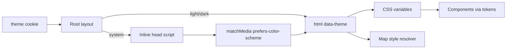

# SDD: Visual tokens + dark mode

- **Repo:** `o000o_active/japan_trip_app`
- **Status:** `implemented`
- **Date:** 2026-10-27
- **Related:** [architecture](../architecture.md), [001 schedule polish](001-schedule-visual-polish.md), [003 unified schedule + zh](003-unified-schedule-zh.md)

## 1. Context / current architecture

Mobile-first Notion itinerary PWA (Next.js 16 / React 19 / Tailwind 4). Colors today are ad-hoc: `text-moss` / `text-hanko` / `bg-hanko` (#b42318) used for primary CTAs **and** secondary links, eyebrows, map pins, day chips, etc. Cards mix `notebook-card` (white + sage border) and inline borders. No app-level dark mode; maps expose a manual Dark tile style in `src/lib/map-styles.ts`. i18n lives in `src/lib/i18n`; theme must not regress zh/en, Schedule Now mode, offline SW/outbox, or the polished timeline.

## 2. Problem and non-goals

**Problem:** Visual system is inconsistent (too much red accent, mixed card chrome, saturated expense category tiles, ALL-CAPS red eyebrows). No dark mode for night use; hard-coded `bg-white` / `text-stone-*` will not follow a theme.

**Non-goals:** New npm deps; redesign of Schedule Now/edit UX beyond stamp/labels; changing Notion schema; rewriting every page layout; custom map tiles beyond existing Dark style; git commits.

## 3. Questions asked and answers

| Question | Answer |
| --- | --- |
| Owner approved design-review items 1 + 5 without further Qs? | Yes — Alex (repo owner) explicitly approved; implement immediately with status `approved`. |
| Theme persistence? | Cookie `theme` = `system` \| `light` \| `dark`; server sets `data-theme` on `<html>`; for `system`, inline head script + `prefers-color-scheme`. |

## 4. Proposed approach, pros / cons, rejected alternatives

**Approach:**

1. **Semantic tokens** in `src/app/globals.css` `@theme` + CSS variables: accent, ok(+soft), maybe(+soft), transit(+soft), ink, ink-muted, surface, canvas, line. Alias legacy `moss`/`hanko`/`paper`/`sage` to the new tokens so gradual migration does not break builds. Dark values under `[data-theme=dark]`. Tailwind `@custom-variant dark` keyed to `data-theme=dark`.
2. **Accent discipline:** red/accent only for one primary action per screen, Now/current state, and destructive confirm buttons. Secondary links → `text-ink-muted` (no underline) or neutral buttons. Visited → ok; pending/maybe → amber; transit → blue-grey. Mute spend category icon tiles (soft tint + ink icon).
3. **Type + cards:** type scale utilities 28/17/15/13/11; body 15px; `tabular-nums` on times/money. One `.notebook-card` / `.card` style: surface, no border, warm faint shadow, radius 16px, padding 12–16.
4. **Japan touches:** `HankoStamp` component; city kanji dictionary beside day headers when city known.
5. **Dark mode:** cookie + settings Appearance row; viewport `themeColor` for both schemes; maps auto-pick Dark tiles when app is dark unless user explicitly saved another style.

**Pros:** Token-driven theme switch (few `dark:` classes); keeps hanko brand; aligns with design review.

**Cons / risks:** Broad class churn may miss a hard-coded color; FOUC if theme script omitted; map “explicit pick” needs a clear default vs user-saved distinction.

**Rejected alternatives:**

| Alternative | Why not |
| --- | --- |
| Per-component `dark:` Tailwind only | Duplicates and drifts from tokens |
| `next-themes` package | No new npm dependencies |
| CSS-only `prefers-color-scheme` without setting | User cannot force light/dark |

**Picture:**

UI — More → Appearance; Schedule Now stamp

```text
+---------------------------+
| More                      |
| Appearance                |
| [ 跟随系统 | 浅色 | 深色 ] |
+---------------------------+
| Schedule day header       |
| Day 3 Kyoto  京都         |
| [済 hanko] Now card       |
+---------------------------+
User: picks 深色 → cookie theme=dark → html[data-theme=dark]
```

Function — theme resolution



## 5. Acceptance criteria and verification

- [x] Semantic tokens defined; components use them for accent/status/surfaces
- [x] Red/accent limited to primary CTA, Now/current, destructive confirm
- [x] Eyebrows grey sentence-case 13px (or removed); one card chrome
- [x] Hanko stamp on Now + visited; city kanji when known
- [x] Appearance setting system/light/dark via `theme` cookie; no flash on load
- [x] Dark maps auto unless explicit style; contrast OK on tab bar, sheet, modals, chips
- [x] i18n: every new string zh + en
- [x] Gates: `npx tsc --noEmit --incremental false`, `npx eslint .`, `npm test`, `npx next build` (2026-10-27; no browser/device spot-check — `next dev` left alone)

## 6. Status history

| Date | Status | Note |
| --- | --- | --- |
| 2026-10-27 | approved | Owner-approved design review items 1+5; implement immediately |
| 2026-10-27 | implemented | Tokens, card chrome, hanko/kanji, theme cookie + dark maps; gates green |
