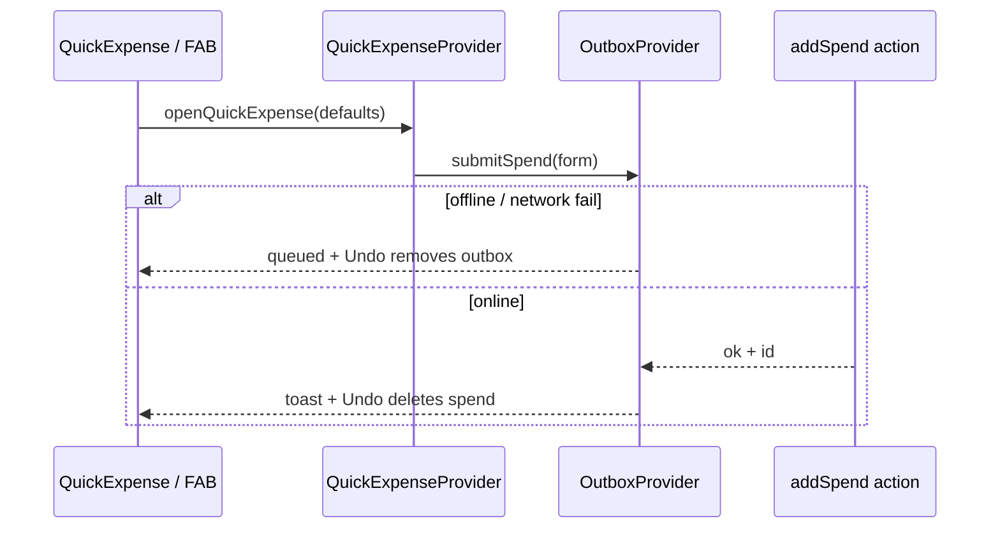

# SDD: Quick expense sheet + expenses hero + form UX

- **Repo:** `o000o_active/japan_trip_app`
- **Status:** `implemented`
- **Date:** 2026-10-27
- **Related:** [architecture](../architecture.md), [003 schedule+zh](003-unified-schedule-zh.md), [004 offline](004-offline-mode.md), [005 tokens](005-visual-tokens-dark-mode.md)

## 1. Context / current architecture

Expenses use `/budget` with `BudgetBoard` / `SpendTimeline` / `AddExpenseFab` → full-page `SlideInPage` + `SpendForm` (selects + native date/time). Writes go through `OutboxProvider.submitSpend` → `runAddSpend` (offline outbox + idempotent `clientId`/`createdAt`). Schedule stop `…` menu is `Modal` `alert` with Park / hide / visited order. List pages (stays/transit/days) still show inline add forms. Editor unlock is a plain text PIN on Settings; `EditOnly` hides edit controls for viewers. i18n is `src/lib/i18n` zh+en; keep Schedule Now mode, Serwist SW, outbox, sync badge, polished timeline.

## 2. Problem and non-goals

**Problem:** Logging spend is too many taps; budget hero hides overspend; forms rely on placeholder-only fields and native date/selects; viewers get silent failure on edit; stop menu copy/order feels system-alert-ish.

**Non-goals:** New npm deps; Notion schema changes; redesign of Now mode / timeline grid beyond stop-menu sheet; full expense edit redesign beyond chips/labels/date picker; git writes; Notion API from the agent.

## 3. Questions asked and answers

| Question | Answer |
| --- | --- |
| Scope / process? | Owner (Alex) approved design-review items 2, 4, 6; write SDD as `approved` and implement immediately — do not wait. |
| PIN length / undo? | Auto-submit at 4 digits + Submit for longer PINs; unlock sheet opens when viewer taps edit/quick-add. Undo toast: remove outbox entry if queued, else `deleteSpend` when synced (return Notion page `id` from `addSpend`). |

## 4. Proposed approach, pros / cons, rejected alternatives

**Approach:**

1. **Item 2 — Quick-add expense sheet:** `quick-expense-provider.tsx` in root layout exposes `openQuickExpense(defaults?)`. Sheet (`quick-expense-sheet.tsx` + Modal sheet): amount-first (40px tabular), ¥/RM toggle (default Yen, last in localStorage), category chips (Food/Transit-as-Transport/Ticket/Shop/Stay/Other), payer chips, optional name, date/time chip → `DatePicker`, day chip from Now/focus, sticky Save. Opens from Expenses FAB, Schedule DayQuickFab spend path, Overview FAB. Save via outbox `submitSpend` + toast Undo.
2. **Item 4 — Expenses hero:** Real % (uncapped); ring fill visual cap 100%; amber ≥90%, accent when over; remaining vs over-by copy; compact FX `¥100 ≈ RM x`; timeline day headers use `formatDay` schedule style + right-aligned day total.
3. **Item 6 — Forms:** Visible labels; `DatePicker` instead of native date; shared `chip-group.tsx` (≥44px, radio) for short enums; stay/transit/place/expense add via sheet + single 添加; place search first + Maps URL under 更多; stop menu sheet order Mark visited → 移到待定 → map hide/show → Cancel; PIN boxes + shake; lock indicator; edit taps open unlock sheet.

**Pros:** Matches review; reuses Modal/outbox/DatePicker; offline-safe spend; consistent chips.

**Cons / risks:** Root provider needs days/people from trip cache + page sync; `ActionResult.id` for undo; broad form churn may miss a native date.

**Rejected alternatives:**

| Alternative | Why not |
| --- | --- |
| Keep SlideIn full-page expense form as primary | Too many steps vs ≤3-tap path |
| Cap budget % at 100 in the label | Hides overspend (explicit review ask) |
| Native `<select>` / `type=date` | Design review: chips + custom picker |

**Picture:**

UI — quick expense sheet:

```text
+---------------------------+
| 添加花费              ✕   |
| [  1250  ]  (¥) (RM)      |  ← autofocus amount
| 餐饮 交通 门票 购物 …     |
| Alex  Pat                 |  ← payer
| Name (optional)           |
| [10月27日 14:32] [Day 3]  |
|===========================|
|         [ 保存 ]          |  ← sticky + safe-area
+---------------------------+
User: amount → category → Save (≤3 taps)
```

Function:



## 5. Acceptance criteria and verification

- [x] Quick sheet opens from Overview / Expenses / Schedule; common path ≤3 taps; offline queue + Undo
- [x] Budget shows real %, over/remaining, FX line; timeline headers schedule-style
- [x] Forms: labels, chips, DatePicker, sheet adds; place 更多; stop menu order/copy; PIN boxes + unlock-on-edit + lock indicator
- [x] Gates: `npx tsc --noEmit --incremental false`, `npx eslint .` (0/0), `npm test` (47), `npx next build`

## 6. Status history

| Date | Status | Note |
| --- | --- | --- |
| 2026-10-27 | approved | Owner design-review approval; implement immediately |
| 2026-10-27 | implemented | Items 2/4/6 shipped; gates green |
