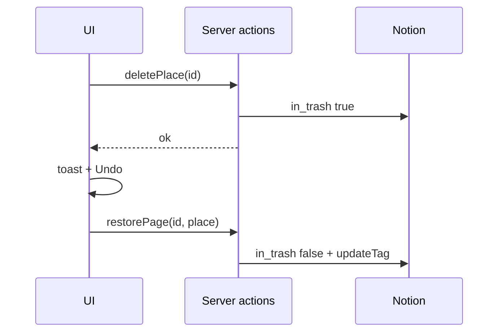

# SDD: Map page redesign + feedback & a11y

- **Repo:** `o000o_active/japan_trip_app`
- **Status:** `implemented`
- **Date:** 2026-10-27
- **Related:** [architecture](../architecture.md), [004 offline](004-offline-mode.md), [005 visual tokens](005-visual-tokens-dark-mode.md), [001 schedule polish](001-schedule-visual-polish.md)

## 1. Context / current architecture

Map lives at `/map` inside `PageShell` with a title block, footnote (“City path uses known centers…”), and a padded rounded `TripMap` (`trip-map.tsx` / `trip-map-loader.tsx`). Pins use default Leaflet icons (not Schedule’s numbered / food / visited markers). `MapStyleSwitch` renders five style chips; CARTO basemaps (`voyager` / `light` / `dark` in `map-styles.ts`) now return “API KEY REQUIRED” tiles — dark mode auto-picks `dark` and is unusable.

Feedback: toasts render at the **top**; deletes use `ConfirmDialog` then trash via Notion `in_trash: true` with no restore path. Visited toggles already skip confirm but have no stamp pop / Undo toast. Loading uses `FlightLoading` spinner text (`src/app/loading.tsx`); no budget/schedule skeleton routes. Sync badge (`sync-badge.tsx`) covers offline/pending but there is no top banner for Notion-fail → cache. Tap targets and meta contrast are uneven; status is sometimes colour-only.

## 2. Problem and non-goals

**Problem:** Map page wastes vertical space and mismatches Schedule pin language; CARTO tiles are broken; feedback/a11y gaps (toast placement, irreversible-feeling deletes, loading chrome, cache notice, 44px / contrast / motion).

**Non-goals:**

- Design-review item 3 (unify Places/Stays/Transit/Expenses into Schedule row style) — logged in `docs/todo.md` only.
- New npm deps; Notion schema changes; starting/killing `next dev`; git writes; `.env*` / `notion/` scripts / Notion API from the agent.
- Replacing Serwist / outbox / zh·en i18n / unified Schedule Now mode.

## 3. Questions asked and answers

| Question | Answer |
| --- | --- |
| Owner approved items 7 + 8 (and map tile fix)? | Yes — Alex (repo owner) explicitly approved; write SDD as `approved` and implement immediately. |
| CARTO replacement? | Keyless Esri Canvas / Street Map URLs verified via curl; optional label overlay layer; graceful fallback if saved style id is gone. |

## 4. Proposed approach, pros / cons, rejected alternatives

**Approach:**

### Item 7 — Map

1. Full-bleed `/map`: map from safe-area top to tab bar; floating title chip only; remove page title block + footnote.
2. Enrich pins with `kind` / `visited` / per-day sight numbers (Schedule language: accent numbered sights, `--maybe` food, ok/muted visited). `fitBounds` all pins on load with bottom-sheet padding.
3. Collapse style chips into one **Layers** button + popover menu in shared `MapStyleSwitch` (Schedule day map inherits it).
4. Draggable/collapsible bottom sheet: cities → days (date, kanji city, stop count); tap day → fly to that day’s pins; CTA “打开行程” → `/schedule?day=<id>`.
5. Replace CARTO URLs with Esri World Street / Light Gray / Dark Gray (+ Reference overlays); `maxZoom: 16` on Canvas; attribution as specified; render optional `overlayUrl` on every Leaflet map using styles; unknown saved id → fall back via `resolveMapStyle`.

### Item 8 — Feedback & a11y

1. Move toasts to bottom above tab bar / safe area; respect `prefers-reduced-motion`.
2. `restorePage(id, entity)` server action (`requireEditor` + `in_trash: false` + `updateTag`). Deletes of place/stay/transit/spend/prep: no confirm → trash + Undo toast calling restore. Keep confirm only where undo isn’t offered (e.g. delete day).
3. Mark visited: no confirm; hanko stamp pop animation (respect reduced motion) + Undo toast (toggle back).
4. Timeline-shaped skeletons for overview / schedule / budget loading UIs.
5. Extend SyncBadge (reuse, don’t duplicate) with a slim top banner for offline + Notion-fail/cache fallback (“Notion 连接失败，显示的是缓存数据” / en equivalent).
6. ≥44px tap targets (tab bar, chips, icon buttons, menu items, row links); meta contrast ≥4.5:1; body 15px; status never colour-alone; reduced-motion on sheet/tab/toast/stamp.

**Pros:** Matches design review; fixes unusable dark maps; Undo reduces confirm friction; a11y baselines shared.

**Cons / risks:** Esri Canvas maxZoom 16 may look soft when zoomed in; restore races if user navigates away mid-toast; bottom sheet + fitBounds padding need tuning on small phones.

**Rejected alternatives:**

| Alternative | Why not |
| --- | --- |
| Keep CARTO + require API key | No new secrets / deps; keyless Esri verified |
| Separate cache banner component | Would duplicate SyncBadge offline messaging |
| Confirm + Undo for deletes | Spec: confirm only when undo isn’t possible |

**Picture:**

UI — Map full-bleed + layers + sheet

```text
+----------------------------------+
| [Map]              [Layers ▾]    |  ← floating chip + layers
|                                  |
|         ·3  ·1                   |
|              ·2 (food)           |
|==================================|  ← sheet handle
| Tokyo 東京                       |
|  Day 1 · 3/28 · 4 stops     →    |
| Kyoto 京都                       |
|  Day 3 · 3/30 · 6 stops     →    |
| [打开行程]                       |
+----------------------------------+
| Overview | Schedule | Map | …    |
User: taps Day 3 → map flies to day pins; 打开行程 → /schedule?day=…
```

Function — delete Undo / restore



## 5. Acceptance criteria and verification

- [x] Map is full-bleed to tab bar; no footnote; floating title chip OK
- [x] fitBounds all pins with sheet padding; pins match Schedule language; visited muted/ok
- [x] Single Layers control (Schedule + Map + preview); Esri tiles + overlays; bad saved id falls back
- [x] Bottom sheet cities→days; fly-to; open schedule CTA
- [x] Toasts bottom + Undo for reversible deletes via `restorePage`; visited stamp pop + Undo; no visited confirm
- [x] Timeline skeletons; SyncBadge top banner for offline/cache; 44px / contrast / reduced-motion
- [x] i18n zh+en for every new string
- [x] Gates: `npx tsc --noEmit --incremental false`, `npx eslint .`, `npm test`, `npx next build` (2026-10-27; no browser/device spot-check — `next dev` left alone)

## 6. Status history

| Date | Status | Note |
| --- | --- | --- |
| 2026-10-27 | approved | Owner-approved design review items 7+8 + map tile fix; implement immediately |
| 2026-10-27 | implemented | Full-bleed map + Esri tiles + layers/sheet; toast Undo/restore; skeletons; SyncBadge banner; a11y; gates green |
