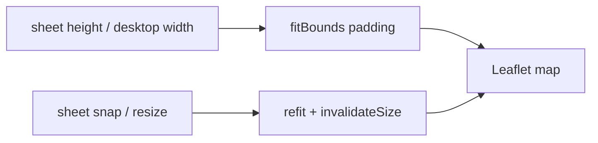

# SDD: Compact Schedule + Budget + Map fixes

- **Repo:** `o000o_active/japan_trip_app`
- **Status:** `implemented`
- **Date:** 2026-10-27
- **Related:** [architecture](../architecture.md), [001 schedule polish](001-schedule-visual-polish.md), [003 unified schedule](003-unified-schedule-zh.md), [006 quick expense](006-quick-expense-forms.md), [007 map feedback](007-map-feedback-a11y.md)

## 1. Context / current architecture

Schedule (`/schedule`) is a full-bleed day map + bottom sheet (`schedule-view.tsx`) with snaps `[0.4, 0.68, 0.92]`. Stop rows in `day-agenda-board.tsx` are bordered cards with map/directions links and full free-time rows between stops — at 390×844 only ~5 stops show with the default map height.

Budget (`/budget`) uses a 144px ring gauge + stacked copy (`budget-board.tsx`), tall `SpendItemCard` notebook cards, and no category chip filter on the timeline.

Map (`/map`) is full-bleed Leaflet (`trip-map.tsx`) with a bottom sheet. Sheet `bottom` is set to `--tab-bar-height` while the page main is already inset by that height (double offset → gap above the tab bar). Zoom/scale sit bottom-right under the sheet. Trip pins reuse per-day sight numbers (duplicate “1”s across cities) and overlap coloured pins. Desktop sheet is full-width. Top-left “地图” pill is inert.

## 2. Problem and non-goals

**Problem:** On-trip phone use needs denser Schedule and Budget lists; Map sheet/controls/markers misbehave at 390 and 1440.

**Non-goals:**

- New npm deps; Notion schema; git writes; `.env*` / `notion/` scripts; killing/restarting `next dev` or deleting `.next/dev`.
- Redesigning overview / lists / prep; changing offline/outbox / Now / edit / quick-add / Undo behaviour beyond layout density.
- Touching README phone/LAN section or `allowedDevOrigins` in `next.config.ts`.

## 3. Questions asked and answers

| Question | Answer |
| --- | --- |
| Owner approval to implement without draft wait? | Yes — Alex (repo owner) explicitly asked today for compact schedule + budget and map UI fixes; write SDD as approved → implement immediately. |
| Category filter UX on budget? | Single horizontal chip row only (no dropdowns/selects). |

## 4. Proposed approach, pros / cons, rejected alternatives

**Approach:**

### Schedule

1. Default sheet snap so map ≈ 28–30dvh on mobile; keep drag handle + fullscreen.
2. Compact day header (one title line + one truncated meta line with date · city · hotel · pending); slimmer day tabs (weekday+date chip row).
3. Single-line-first stop/transit rows (~44px), hairline dividers, thin free-time/walk labels in the rail (hide gaps &lt; 15 min); map/directions via ⋯ sheet or tiny inline actions.
4. Smaller 済 stamp; keep 已完成 (n) collapsed group; Now highlight + auto-scroll unchanged.
5. Tighten AgendaEditTable paddings / inputs; 2-col grid where it fits.

### Budget

1. Replace ring with ≤90px summary strip (spent · budget · remaining/over + thin progress + FX).
2. h-8 segmented tabs; horizontal category chips filtering the timeline.
3. Compact expense rows (~44–48px) + slim sticky day headers; compact category % rows.
4. Keep FAB / quick-add / Undo / SyncBadge.

### Map

1. Anchor sheet to container bottom (`bottom: 0` — main already clears tab bar); snaps ~120px / 45dvh / 85dvh; internal scroll.
2. Zoom top-right under Layers; offset scale/attribution above sheet; respect safe-area top.
3. fitBounds padding from sheet height (+ desktop left pad); refit on snap.
4. Trip-wide: day-coloured dots / D{n} badges (no per-day sight numbers); offset/cluster overlaps; z-order selected &gt; visited &gt; others; popup autoPan padding.
5. Desktop ≥1024: left ~360px panel; make top-left control reset view (全部).
6. Do not regress `/schedule` day-map controls; verify dark Esri tiles + Layers popover.

**Pros:** More stops/expenses per phone screen; map usable with sheet open; no new deps.

**Cons / risks:** Denser rows may feel tight for large fonts; cluster offset is heuristic not a full MarkerCluster lib.

**Rejected alternatives:**

| Alternative | Why not |
| --- | --- |
| Hide schedule map by default | Owner wants map + more list density, not map gone |
| Budget category `<select>` | Owner: chips only |
| leaflet.markercluster dependency | No new npm deps |

**Picture:**

UI — Schedule compact stop row

```text
+----------------------------------+
| [map ~28dvh]            [⛶]      |
|==== handle ======================|
| [全][周一28][周二27]…             |
| Day 3 · Shibuya…     [锁][编辑]  |
| 10/27 周二 · Tokyo · 🏨… · 2待定›|
| 10:00 ① Senso-ji · Sight · Asa…⋯ |
|       · 30 分钟 · 步行 4 分 ·     |
| 10:45 ② Nakamise · Shop · …   ⋯  |
User: scrolls list — ≥8–9 stops in first viewport with default map
```

UI — Budget strip + chips

```text
| 已花 RM… · 预算 RM… · 超支 RM…   |
| ████████░░░░  FX ¥100≈RM…        |
| [时间线|分类|前10]                |
| [全部][餐饮][交通]… →             |
| 10月27日 周二 · RM 1,479.13      |
| 12:30 🍜 Lunch · Alex    ¥2,400  |
```

UI — Map sheet + controls

```text
| [全部]              [图层] [+][-] |
|            pins…                  |
|==================================| sheet
| Tokyo 東京 …                      |
| (anchored to top of tab bar)      |
+----------------------------------+
|         bottom nav                |
```

Function — map fitBounds padding



## 5. Acceptance criteria and verification

- [x] Schedule at ~390 width: default map ~28–30dvh; compact header/tabs; dense stop rows; gaps &lt;15m hidden; Now/edit/offline preserved
- [x] Budget: compact strip ≤~90px; chip filter; dense rows; FAB/Undo intact
- [x] Map: no gap above tab bar; zoom not under sheet; fitBounds accounts for sheet; trip pins not duplicate sight numbers; desktop left panel; reset control
- [x] zh/en dictionaries stay in sync
- [x] `npx tsc --noEmit`, `npm run lint`, `npm test`, `npx next build` pass (evidence in status history / chat summary)
- [ ] Visual check in browser — agent cannot drive a browser; reasoned from CSS/layout; Alex verifies on device

**Gate outputs (2026-10-27):** `tsc --noEmit` clean · `eslint` 0 errors 0 warnings · Vitest 9 files / 51 tests passed · `next build` compiled successfully

## 6. Status history

| Date | Status | Note |
| --- | --- | --- |
| 2026-10-27 | approved | Owner asked for compact schedule/budget + map fixes; implement immediately |
| 2026-10-27 | implemented | Compact schedule/budget UI + map sheet/controls/markers/desktop panel; gates green |
| 2026-10-27 | implemented | Round 2 — map control stack, day-meta/scroll, denser budget rows, popup padding, day-badge pixel clusters |
| 2026-10-27 | implemented | Round 3 — schedule map compact controls, slim Now banner, denser gaps, dark-mode day badges + Leaflet chrome |
| 2026-10-27 | implemented | Round 4 — schedule free-time/walk gap rows capped at 18px (rail continues; stop rows stay ~44px) |

## Round 2 (headless Chrome follow-ups)

Owner approval: same task as this SDD; implement immediately after Round 1 visual review at 390×844 / 1440×900.

### Fixes

1. **Schedule / map corner controls** — One vertical stack (8px gap): layers → fullscreen → hide names → zoom ±; safe-area top-right; custom zoom buttons (no overlapping Leaflet control). Same layers+zoom stack on `/map`.
2. **Day meta line** — Date, city (`Tokyo` + kanji), and 待定 link are `whitespace-nowrap` / `shrink-0`; only hotel name truncates (`min-w-0 flex-1 truncate`).
3. **Now/Next scroll** — Prefer `[data-now-card]`; `scroll-margin-top` = sticky header height + 8px; `scrollIntoView({ block: "start" })`.
4. **Budget rows** — ~44px: no leading bullet column; 24px icon; name + payer inline; amount + ≈RM at `text-[11px]`; day headers `h-7` (~28px); 8px gap under chip row.
5. **Category chips** — `scrollbar-none` + right-edge fade mask so the last chip isn’t cut without affordance.
6. **Map popups** — `autoPan` + `keepInView` + `maxWidth` 260; `autoPanPaddingTopLeft` clears 全部标记 (~120×72); bottom padding follows sheet height.
7. **Day badges** — Pixel-distance clustering (`< 28px`) on `zoomend`/`moveend` via `map-day-clusters.ts`; group badge (`D5–7` / `D5·D6·D8`) taps → `fitBounds` to members. No new deps.

### Gates (2026-10-27 Round 2)

- `npx tsc --noEmit` — clean
- `npm run lint` — 0 errors, 0 warnings
- `npm test` — 10 files / 57 tests passed
- `npx next build` — compiled successfully

## Round 3 (headless Chrome follow-ups)

Owner approval: same task as this SDD; implement immediately after Round 2 visual review at 390×844.

### Fixes

1. **Schedule embedded map controls** — Top-right: layers / fullscreen / hide-names as 36px buttons (gap 6px). Zoom ± as one joined 32px pair at bottom-left above the scale; hidden on `@media (pointer: coarse)` (pinch zoom). Attribution stays `text-[10px]` and unobstructed.
2. **Now/Next banner** — Slim one-line (~48px): `下一站 · 13:00 · Name · 美食` with accent left border; 40px map/route icon buttons on the right; tap scrolls to the agenda row.
3. **Gap labels** — `text-[11px] leading-4` with `py-px` (~18px rows) in the rail column. Target: ≥7 timed rows visible below the header at 390×844 with default map when the Now banner is shown.
4. **Map dark mode** — Grouped day badges (`D2–3`, `D5–7`) use fixed light-mode ink pill (`#1c1917` + white text) in both themes. Leaflet attribution + scale styled for `[data-theme="dark"]`.

### Gates (2026-10-27 Round 3)

- `npx tsc --noEmit` — clean
- `npm run lint` — 0 errors, 0 warnings
- `npm test` — 10 files / 57 tests passed
- `npx next build` — compiled successfully

## Round 4 — gap rows ≤18px (rail through; stops stay ~44px)

### Gates (2026-10-27 Round 4)

- `npx tsc --noEmit` — clean
- `npm run lint` — 0 errors, 0 warnings
- `npm test` — 10 files / 57 tests passed
- `npx next build` — compiled successfully
