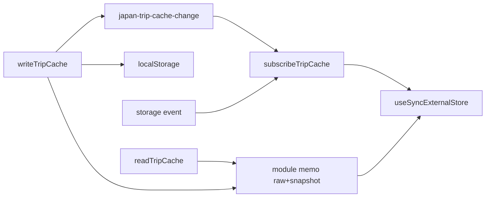
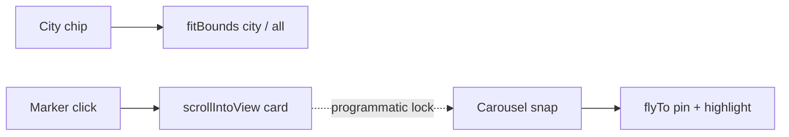

# SDD: Compact all pages (Schedule row language)

- **Repo:** `o000o_active/japan_trip_app`
- **Status:** `implemented`
- **Date:** 2026-10-27
- **Related:** [architecture](../architecture.md), [007 map feedback](007-map-feedback-a11y.md), [008 compact schedule/budget/map](008-compact-schedule-budget-map.md), [todo](../todo.md)

## 1. Context / current architecture

SDD 008 densified `/schedule`, `/budget`, and `/map`. Remaining surfaces still use tall `notebook-card` heroes and stacked cards: Overview (`/`), `/lists`, `/places`, `/stays`, `/transit`, `/days`, `/prep`, `/settings`, expense detail `/budget/[id]`, `/~offline`, plus add/edit sheets. Design-review item 3 (todo) asked for one Schedule-style row system everywhere.

Reference layouts live in `schedule-view.tsx` / `day-agenda-board.tsx` (… action sheet) and `budget-board.tsx` (SummaryStrip + ChipRow).

## 2. Problem and non-goals

**Problem:** List and overview screens show too few lines at 390×844; selects on Places; inline Edit/Delete on cards; `/~offline` production crash (React #185 max update depth).

**Non-goals:**

- New npm deps; Notion schema; git writes; `.env*` / `notion/` scripts; killing/restarting `next dev` or deleting `.next/dev`.
- Regressing `/schedule`, `/budget`, `/map` compact behaviour from SDD 008.
- Changing README phone/LAN section or `allowedDevOrigins`.
- Swipe-to-delete on prep; redesigning bottom nav targets (&lt;44px).

## 3. Questions asked and answers

| Question | Answer |
| --- | --- |
| Owner approval to implement without draft wait? | Yes — Alex asked today to make all pages compact like Schedule; this is todo item “Unify list screens…”; implement immediately. |
| Filter UX on Places? | Chip rows only (no `<select>`), matching Budget. |

## 4. Proposed approach, pros / cons, rejected alternatives

**Approach:**

1. Extract shared primitives under `src/components/compact/`: `PageHeader`, `SectionHeader`, `CompactRow`, `SummaryStrip`, `ChipRow`, `ActionSheet` (+ more button), compact field classes.
2. Apply per route (see inventory below). Keep Schedule/Budget/Map as reference; only soft-align headers if needed without density regressions.
3. Move per-row Edit/Delete/Map/Notes into `…` ActionSheet.
4. Fix `/~offline`: stable `useSyncExternalStore` snapshot via memoized `readTripCache` + same-tab change event; compact the page UI.
5. Keep zh default + en dictionaries in sync; type scale 11/12/13/14/15/17px; tabular-nums for times/money; tap targets ≥40px.

### Route inventory

| Route / surface | Change |
| --- | --- |
| `/` Overview | Slim `PageHeader`; `SummaryStrip` (Day n/N · span · cities); slim next-stop banner; `CompactRow`s for stay / spend / flights / links; drop tall countdown hero card |
| `/lists` | Slim header; sub-nav → `ChipRow`; category tiles → `CompactRow`s with count meta |
| `/places` | Slim header + add; sub-nav chips; status + type `ChipRow`s (no selects); search `h-9`; place → `CompactRow` + 済/`…`; notes in sheet |
| `/stays` | Slim header; date-column `CompactRow`; copy conf icon; `…` Edit/Delete/Map |
| `/transit` | Slim header; time/date column + mode; from→to; `…` Edit/Delete |
| `/days` | Slim header; `CompactRow` date · city \| Day name + status chip + `…`/edit |
| `/prep` | Slim header; progress strip; ~44px check rows; delete via icon/`…`; compact add row |
| `/settings` More | Slim header; h-8 segmented lang/theme; tool/status as compact rows |
| `/spend` | Redirect only — no UI change |
| `/budget` | Reference (SDD 008) — no density change |
| `/budget/[id]` | Slim header; ~36px key-value rows / compact form |
| `/schedule` | Reference — unchanged |
| `/map` | Reference densified in SDD 008; **carousel append (§7)** replaces bottom sheet |
| `/~offline` | Compact + fix #185 snapshot loop |
| Sheets/forms (place/stay/transit/day/agenda/spend/prep/unlock/confirm/quick-expense/list-add) | Compact controls, tighter gaps, sticky footers where sheets already have them |
| Bottom nav | Unchanged (≥44px) |

**Pros:** One visual language; more info per phone screen; shared primitives reduce one-offs.

**Cons / risks:** Dense rows may feel tight with large Dynamic Type; many files touched in one pass.

**Rejected alternatives:**

| Alternative | Why not |
| --- | --- |
| Leave cards, only shrink padding | Still card-heavy; fails design-review item 3 |
| Places `<select>` filters | Owner: chips only |
| Premature abstraction without Schedule parity | Extract from working Schedule/Budget patterns |

**Picture:**

UI — Places list (phone)

```text
+----------------------------------+
| 指南                    [添加]    |
| 地点                              |
| [概览][地点][住宿][交通] →        |
| [搜索……………………]                   |
| [全部][待定][已排][已访问] →      |
| [全部类型][景点][美食]… →         |
| 浅草寺 · 景点              済  ⋯  |
| Day 2 · Asakusa & Ueno            |
User: taps ⋯ → ActionSheet (编辑备注 / 地图 / …)
```

UI — Overview strip

```text
| Day 3/8 · 10月25日–11月1日 · 东京→… |
| 下一站 · 13:00 · Name · 美食   ›  |
| 今晚  Hotel Name · address        |
| 今日花费  RM …                    |
```

Function — offline snapshot store



## 5. Acceptance criteria and verification

- [x] Shared compact primitives extracted and used on list/overview/settings/prep/offline/detail
- [x] Places/Stays/Transit/Days/Lists/Prep/Overview/Settings/Offline densified; Edit/Delete in `…` sheets where applicable
- [x] Places filters are chip rows (no selects); Unvisited label → Scheduled / 已排
- [x] `/schedule`, `/budget`, `/map` not regressively redesigned
- [x] `/~offline` no longer loops (stable getSnapshot); compact UI
- [x] zh/en dictionaries stay in sync for new/changed strings
- [x] ≥40px action targets; reduced-motion respected via existing Modal
- [x] `npx tsc --noEmit`, `npm run lint`, `npm test`, `npx next build` (evidence in status history / chat)
- [ ] Device visual check at 390×844 — Alex verifies

## 6. Status history

| Date | Status | Note |
| --- | --- | --- |
| 2026-10-27 | approved | Owner asked to compact all pages like Schedule; todo item 3 |
| 2026-10-27 | implemented | Shared primitives + all listed surfaces + offline #185 fix |
| 2026-10-27 | implemented | Gates: `tsc --noEmit` clean · eslint 0/0 · Vitest 12 files / 61 tests · `next build` ok |
| 2026-10-27 | approved | Owner (Alex, 10:01 MYT): replace `/map` bottom drawer with city chips + place carousel; implement immediately |
| 2026-10-27 | implemented | Map carousel: removed sheet; top city chips; bottom snap carousel; marker↔card sync |
| 2026-10-27 | approved | Owner Round 2: stays date column, PageHeader add centering, map chrome padding |
| 2026-10-27 | implemented | Round 2: stays/transit date cleanup; PageHeader h-8 action; measured map pads + visible-band fly |
| 2026-10-27 | implemented | Round 2 gates: `tsc --noEmit` clean · eslint 0/0 · Vitest 13 files / 69 tests · `next build` ok |

## 7. Map carousel (append — owner 2026-10-27 10:01 MYT)

**Owner approval:** Alex asked today to replace the `/map` snapping city/day bottom sheet with a top city chip bar + bottom place carousel. Implement immediately (no draft wait).

### Problem

The day/city bottom sheet (mobile snap + desktop left panel) hides map area and is not the right interaction for on-trip place browsing.

### Approach

1. **Remove** the snapping bottom sheet and its snap/refit code (mobile + desktop left panel).
2. **Top:** single-row horizontal city chips under `safe-area-inset-top` — `全部` / All · cities in trip order (zh kanji via `cityKanji`, en romaji). Tap → `fitBounds`/`flyToBounds` for that city’s markers (`全部` = whole trip). Active chip highlighted. Replaces “全部标记” pill. Layers top-right (aligned with chip bar); zoom ± only `@media (pointer: fine)`, right side above carousel, no overlap with chips/carousel/attribution.
3. **Bottom:** horizontal swipeable carousel of compact place cards above the tab bar (`env(safe-area-inset-bottom)`). Cards ~80px tall; ~80vw mobile (peek next) / ~320px desktop; CSS `scroll-snap-x` mandatory + `snap-center`. Schedule typography: line1 = day badge (D*n*, day colour) · time (tabular-nums) · name (truncate 14px semibold); line2 = type · city muted 12px; right = MapsPinLink + DirectionsLink (40px). Order by day then time; all places with coords; filter by active city chip.
4. **Sync:** card snap → pan/fly to marker (zoom ≥ current or city zoom) + highlight (bigger + ring + z-top). Marker tap (or cluster member after zoom) → smooth-scroll carousel to card. Guard programmatic scroll so it does not re-pan to a different card.
5. **Padding:** `fitBounds` / autoPan account for chip bar (top) and carousel (bottom). Prefer carousel highlight over popups.
6. Keep D1–D8 badges, pixel-distance merge (D5–7), dark contrast, Esri tiles + labels.
7. Desktop ≥1024: same chip bar + carousel (no left panel).
8. No geocoded places → compact empty message instead of carousel.
9. Unit test for pure helpers (city order / carousel filter-sort).

Reuse `src/components/compact/*` (e.g. `ChipRow`) where they fit. Hard rules unchanged (no git / `.env*` / notion / new deps / no restart of `:3000`).

**Picture — UI**

```text
+----------------------------------+
| [全部][東京][京都][大阪]…  [Layers]|
|                           [+][-] |  ← fine pointer only
|                                  |
|            (map pins)            |
|                                  |
|  | card |  card*  | card | →     |  ← snap carousel ~80px
+----------------------------------+
|          bottom tab bar          |
```

**Picture — Function**



### Acceptance (map carousel)

- [x] Bottom sheet / left panel removed
- [x] Top city chips + bottom place carousel (mobile + desktop)
- [x] Chip ↔ fitBounds; card ↔ marker sync without feedback loops
- [x] Padding clears chips + carousel; D*n* merge + Esri preserved
- [x] Empty state; pure helper unit test; zh/en sync
- [x] Gates: `tsc` · lint · test · `next build`

## 8. Round 2 (append — owner 2026-10-27)

**Owner approval:** same SDD 009 task; headless 390×844 review follow-ups. Implement immediately.

### Fixes

1. **Stays date column:** leading = compact `M/D` + nights (`{n}晚` / `{n} nights`, tabular-nums 12px), or `M/D–D` when nights unknown. Remove duplicated range from primary (`meta`); primary = hotel name only; secondary = address · 确认码 (copy icon stays). Transit: leading date uses `formatTabDate` when no time; do not repeat that date in secondary. Days unchanged (date is intentional primary, not duplicated).
2. **PageHeader action:** shared slot forces `h-8 px-3 inline-flex items-center justify-center leading-none` on nested buttons; header row `items-center` (fixes top-aligned「添加」pill).
3. **Map chrome padding:** measure chip-bar bottom and carousel height; `fitBounds` / city fly / pin fly / single-pin setView use top = chipBottom+16 and bottom = carouselH+16; fly/setView centres offset into the visible band between chips and carousel.

Hard rules unchanged (no git / `.env*` / notion / new deps / no restart of `:3000` / keep README LAN + `allowedDevOrigins` / zh·en sync).

### Acceptance (Round 2)

- [x] Stays primary shows full hotel name; date column compact; no date dup on transit when leading shows date
- [x] PageHeader add button vertically centred (h-8)
- [x] Map city-chip / card fly clears chip bar + carousel
- [x] Gates: `tsc` · lint · test · `next build`
