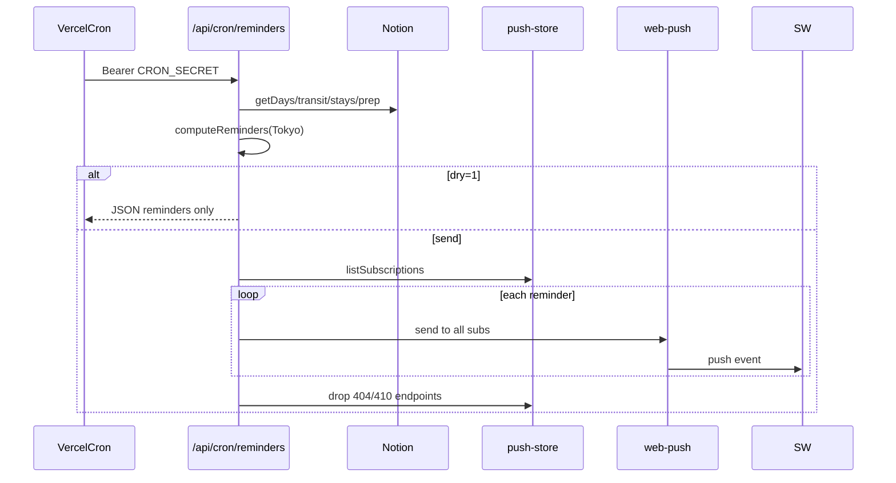
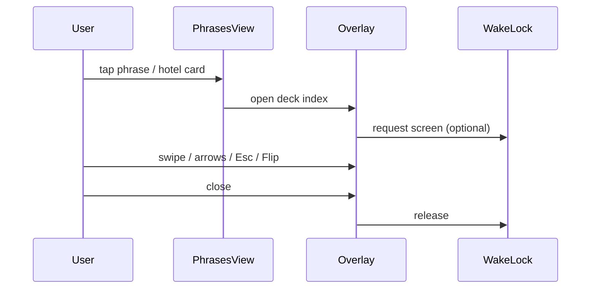

# SDD: Schedule swipe + haptics + Web Push + phrase cards

- **Repo:** `o000o_active/japan_trip_app`
- **Status:** `implemented`
- **Date:** 2026-10-27
- **Related:** [architecture](../architecture.md), [004 offline](004-offline-mode.md), [007 feedback/a11y](007-map-feedback-a11y.md), [009 compact](009-compact-all-pages.md), [todo](../todo.md), README Push reminders setup

## 1. Context / current architecture

Schedule stop rows live in `day-agenda-board.tsx` (used from `schedule-view.tsx`). Visited toggles go through `useOutbox().markVisited` (online + IndexedDB outbox) with Undo via `useToast`. Row “…” opens a Modal action sheet (mark visited, park, maps, hide pin). Edit mode (`?mode=edit`) swaps the board for `AgendaEditTable` (drag/reorder); view/now modes keep the board.

Haptics already exist: `src/lib/haptic.ts` (`navigator.vibrate` + iOS switch-checkbox overlays), `HapticProvider`, Settings `HapticToggle`. Call sites today: `ActionForm` success/error, control taps via provider. Hanko stamp has `hanko-pop`; toasts use `toast-in`. No Web Push, no `/phrases` route.

## 2. Problem and non-goals

**Problem:** On the phone, marking a stop visited or opening “…” requires tapping into the sheet. Visited / expense / prep feedback is silent unless the user hit a button the overlay already covers. Pre-trip reminders and offline phrase cards are missing.

**Non-goals:**

- Redesign `/map` or other pages; change Notion schema / `notion/` submodule.
- Git writes, deploy, `.env*` edits in this work (push VAPID keys are documented for run 2 only).
- Swipe-to-delete on prep (still backlog).
- Native push apps / APNs; phrases as a second Notion DB.

## 3. Questions asked and answers

| Question | Answer |
| --- | --- |
| Owner approval to skip draft wait? | Yes — Alex (2026-10-27 23:44 MYT) approved items 1–4 scoped below; implement 1+2 immediately; spec 3+4 now. |
| Swipe directions? | Right = toggle visited (済); left = open existing “…” sheet. |

## 4. Proposed approach, pros / cons, rejected alternatives

### Item 1 — Schedule swipe actions (**run 1 — implemented**)

**Approach:** Pure helpers in `src/lib/swipe.ts` (axis lock, threshold ~72px / velocity, rubber-band). Reusable `SwipeRow` (`src/components/compact/swipe-row.tsx`) with Pointer Events, `touch-action: pan-y`, reveal layers (right→green 済, left→“…”) , snap-back, click suppression after swipe, ignore inputs/buttons / `data-no-swipe`. Wire only on Schedule place rows in `day-agenda-board.tsx`. Disable when it would fight edit drag (board already hidden in `?mode=edit`). Keep existing visited button in sheet and “…” control. Unit tests in `swipe.test.ts`.

### Item 2 — Haptics + micro-animations (**run 1 — implemented**)

**Approach:** Extend `haptic.ts` with `haptic(kind)` (`tap` \| `success` \| `warning` \| `error` \| `undo`); keep `hapticTap` / `hapticSuccess` / `hapticError`. Settings toggle gates all kinds. Call on visited toggle (incl. swipe), quick-expense save, undo, prep check, swipe threshold (light tap once). CSS keyframes (tokens, dark-ok, `prefers-reduced-motion`): refine 済 pop; expense success check; toast slide-in. Pure tests for kind→pattern / enabled.

### Item 3 — Web Push pre-trip / day-before (**run 2 — implemented**)

**Goals:** Opt-in evening-before reminders (Hobby: one cron/day at 11:00 UTC = 20:00 JST). Works when app is closed (SW). No Notion schema / submodule changes.

**Reminder rules** (`src/lib/reminders.ts` `computeReminders`, Asia/Tokyo):

| Kind | When | Example (zh) |
| --- | --- | --- |
| (a) Transit tomorrow | Legs dated tomorrow (skip Walk) | `明天 10:00 新干线` / `东京→京都，记得取票` |
| (b) Hotel check-in tomorrow | Stay check-in date = tomorrow | `明天入住` + name/time |
| (c) Prep | Unchecked prep when days-until-departure ∈ `{3,1}` (configurable) | count + first titles → `/prep` |
| (d) Departure tomorrow | First trip day = tomorrow (optional, default on) | `明天出发` → `/` |

Stable ids, dedupe, default locale zh (en supported). Unit tests: TZ edges, empty/past, multi-leg, prep thresholds.

**Storage (not Notion):** `src/lib/push-store.ts` — primary Upstash Redis REST via plain `fetch` (`KV_REST_API_URL`+`TOKEN` or `UPSTASH_REDIS_REST_*`); fallback read-only `PUSH_SUBSCRIPTIONS` JSON array + Settings “copy subscription JSON”.

**Routes:** `POST`/`DELETE` `/api/push/subscribe` (editor session), `POST` `/api/push/test`, `GET` `/api/cron/reminders` (`Authorization: Bearer ${CRON_SECRET}`; `?dry=1`; dry-only optional `?now=<ISO>`). Node runtime, force-dynamic. Gone subs (404/410) removed from KV. Serwist: NetworkOnly for `/api/push` + `/api/cron`.

**SW:** `push` shows title/body/icon `/icon/192`/tag/`data.url`; `notificationclick` prefers same-origin client, focuses + `navigate` in try/catch (iOS WebKit) with `openWindow` fallback.

**UX (Settings → Device):** compact “行前提醒 / Trip reminders” card — support state, iOS Home Screen steps, Enable / Disable / Send test / Copy JSON; requires editor unlock; degrades when VAPID missing.

**Env:** `NEXT_PUBLIC_VAPID_PUBLIC_KEY` (or `VAPID_PUBLIC_KEY`), `VAPID_PRIVATE_KEY`, `VAPID_SUBJECT`, `CRON_SECRET`, optional KV (`KV_REST_API_URL`/`TOKEN` or `UPSTASH_REDIS_REST_*`) / `PUSH_SUBSCRIPTIONS`. Documented in README Push reminders setup (`.env.example` left unchanged on purpose). `vercel.json` cron `0 11 * * *` → `/api/cron/reminders`. Dry-run: `?dry=1` and optional `?now=<ISO>` (dry only).

**Picture:**

UI — Settings reminders

```text
+--------------------------------------+
| 行前提醒 / Trip reminders            |
| Evening-before transit / stay / prep |
| Status: Reminders off | On | iOS…    |
| [开启] [发送测试] [复制订阅 JSON]     |
+--------------------------------------+
```

Function — daily cron



### Item 4 — Japanese phrase cards `/phrases` (**run 3 — implemented**)

**Goals:** Offline-friendly phrase deck (allergy/diet, order, directions, transit, emergency, shopping, hotel) + hotel address cards from Stays + custom local phrases. zh/en UI chrome; Japanese + reading + meaning; full-screen “show to staff”.

**UX:**

```text
More / Settings / Overview·Schedule「日语」→ /phrases
[Cat chips: 全部|过敏|点餐|问路|交通|紧急|购物|酒店|我的]
┌ 酒店地址 · 给司机看 ─────────────────┐
│ Hotel Tokyo · 東京都…              › │  tap → fullscreen
└──────────────────────────────────────┘
┌ すみません                           ┐
│ すみません · 不好意思                 │
└──────────────────────────────────────┘
Fullscreen: huge JA (auto-fit) + reading/zh; Esc/close;
←/→ or swipe; Flip 180°; Screen Wake Lock while open
```

**Files:** `src/app/phrases/page.tsx`, `src/components/phrases-view.tsx`, `src/lib/phrases.ts` (+ `phrases.test.ts`), Serwist precache `/phrases`, Settings + bottom-nav More match + Overview/Schedule quick link, i18n keys.

**Data / storage:** Bundled `BUILTIN_PHRASES` (no Notion). Hotel cards via `buildHotelCards(stays)` (`addressJa`/`japaneseAddress` if present else `address` + 「この住所までお願いします」). Custom: `japan-trip:custom-phrases-v1` localStorage (versioned JSON). Stays offline from trip snapshot.

**Env vars:** none.

**Acceptance:** `/phrases` works offline (bundled data + SW precache + stays snapshot). Every string zh+en. ≥44px controls; reduced-motion ok. Does not alter `/map`.

**Test plan:** `phrases.test.ts` — categories non-empty, unique ids, custom parse/serialize, hotel card helpers.

**Pros:** Phone-speed visited marking; consistent feedback; push/phrases scoped without Notion churn.

**Cons / risks:** Swipe vs scroll misfires (mitigated by axis lock); iOS vibrate limits; push subscription storage choice deferred; phrase content quality is editorial.

**Rejected alternatives:**

| Alternative | Why not |
| --- | --- |
| Long-press only for visited | Owner asked for swipe |
| New haptic library | Reuse existing `haptic.ts` |
| Notion DB for phrases / push subs | Hard rule: no Notion schema |
| Favorites / TTS in v1 | Owner asked show-to-staff + custom CRUD; TTS deferred |

**Picture (item 4):**

UI — phrases + show-to-staff

```text
+--------------------------------------+
| 常用日语              [添加]         |
| [全部][过敏][点餐]…[我的]            |
| 酒店地址 · 给司机看                  |
| Hotel · address                    › |
| えびアレルギーがあります             › |
User: tap row → fullscreen huge JA
```

Function — show overlay + wake lock



## 5. Acceptance criteria and verification

### Item 1 (run 1)

- [x] Swipe right on Schedule place row toggles visited via same outbox path + Undo toast
- [x] Swipe left opens the same “…” sheet as the button
- [x] Axis lock / pan-y; no steal of day-tab horizontal scroll; click suppressed after swipe
- [x] No swipe in edit mode path (board not mounted); keyboard/tap alternatives remain
- [x] `src/lib/swipe.test.ts` covers axis, threshold, velocity, direction

### Item 2 (run 1)

- [x] `haptic(kind)` + Settings off disables all; existing exports work
- [x] Haptics on visited, expense save, undo, prep check, swipe threshold
- [x] Micro-anims for 済 pop, expense success, toast in; reduced-motion safe
- [x] Pure haptic mapping tests

### Item 3 (run 2)

- [x] Subscribe / unsubscribe UI (Settings); editor gate; iOS install steps
- [x] `computeReminders` + unit tests; push-store parse tests
- [x] Cron `/api/cron/reminders` + `vercel.json` daily 11:00 UTC; SW push handlers
- [x] Graceful degrade without env; README Push reminders env list (no `.env.example` edit)

### Item 4 (run 3)

- [x] `/phrases` deck offline; zh/en chrome; linked from More / Settings / Overview / Schedule
- [x] Hotel cards from Stays + custom localStorage CRUD
- [x] Full-screen show mode (wake lock, flip, swipe/arrows)
- [x] `phrases.test.ts` + SW precache `/phrases`

### Review fixes (run 4)

- [x] Velocity-only swipe commit requires `|offset| >= 32` and matching velocity/offset signs
- [x] SW `notificationclick`: try/catch `navigate`, prefer same-origin client, `openWindow` fallback
- [x] Cron `?dry=1&now=<ISO>` for dry-run instant; ignored on real sends; README documented
- [x] README lists all push env vars; no claim that `.env.example` was updated
- [x] `data-haptic="manual"` skips provider tap so undo/success/error fire once

### Verification (run 4)

- `npx tsc --noEmit`, `npm run lint`, `npm test`, `npx next build` — all pass (recorded in final message)

## 6. Status history

| Date | Status | Note |
| --- | --- | --- |
| 2026-10-27 | draft | Owner-approved scope; implement 1+2 same run |
| 2026-10-27 | implemented | Items 1–2 shipped; 3–4 design-only pending runs 2–3 |
| 2026-10-27 | implemented | Item 3 Web Push reminders shipped (run 2); item 4 still pending |
| 2026-10-28 | implemented | Item 4 Japanese phrase cards `/phrases` shipped (run 3); SDD complete |
| 2026-10-28 | implemented | Run 4 review fixes (swipe velocity gate, SW navigate, dry `now`, haptics, README env) |
