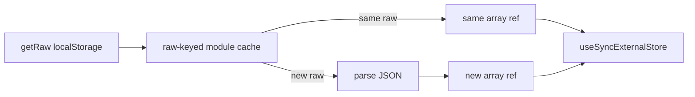

# SDD: Fix /phrases React #185 (useSyncExternalStore snapshot stability)

- **Repo:** `o000o_active/japan_trip_app`
- **Status:** `implemented`
- **Date:** 2026-10-28
- **Related:** [architecture](../architecture.md), [010 phrases](010-swipe-haptics-push-phrases.md), [009 offline #185](009-compact-all-pages.md)

## 1. Context / current architecture

`/phrases` (`src/components/phrases-view.tsx`) uses `useSyncExternalStore` for:

- Custom phrases from `localStorage` (`readCustomPhrases` / `CUSTOM_PHRASES_STORAGE_KEY`)
- Hotel stays from server props or trip itinerary snapshot (`readTripCache` / `subscribeTripCache`)

`readTripCache` already memoizes the parsed snapshot by raw string (React #185 fix from offline work). Custom phrase reads re-parsed JSON on every `getSnapshot` call. Several getSnapshot / serverSnapshot lambdas returned fresh `[]` literals.

## 2. Problem and non-goals

**Problem:** Production `/phrases` crashes on hydrate with React error #185 (Maximum update depth exceeded). Cause: getSnapshot returns a new array/object reference every call, so React treats the store as changed → re-render → loop.

**Non-goals:**

- UI/behaviour changes beyond referential stability
- Redesign `/map` or other pages; Notion / `.env*` / git / deploy
- jsdom-based component tests for the overlay

## 3. Questions asked and answers

| Question | Answer |
| --- | --- |
| Owner approval to skip draft wait? | Yes — Alex (2026-10-27 23:44 MYT) TASK RUN 5; write SDD + implement same run. |
| Scope of other USES sites? | Grep + fix any getSnapshot that returns fresh arrays/objects the same way; leave primitive snapshots alone. |

## 4. Proposed approach, pros / cons, rejected alternatives

**Approach:**

1. Module-level frozen `EMPTY_*` constants for empty arrays used as snapshots.
2. Cache parsed custom phrases keyed by raw localStorage string; export pure `readCachedCustomPhrases(getRaw)` (injectable getter, no jsdom) and wire `readCustomPhrases` through it.
3. Keep / confirm trip-cache raw-keyed memo; export stable empty stays helper; in `phrases-view`, derive stays via `useMemo` from a stable `readTripCache` snapshot (or stable empty) instead of `?? []` / inline `resolveStays` snapshots.
4. Server snapshots return the same EMPTY constants / `null`, never fresh `[]`.
5. Vitest: same raw → same reference; changed raw → new reference.

**Pros:** Fixes #185 with minimal surface; matches existing trip-cache pattern; testable without DOM.

**Cons / risks:** Module memo must invalidate when raw changes (keyed compare handles this). Cross-tab storage still works via subscribe + re-read.

**Rejected alternatives:**

| Alternative | Why not |
| --- | --- |
| Replace USES with useState+useEffect | Larger behaviour change; worse SSR/hydration story |
| JSON.stringify compare in render | Still allocates; misses React’s Object.is contract |

**Picture:** none — pure referential-stability fix; no UI or user-flow change.

## 5. Acceptance criteria and verification

- [x] Custom-phrase getSnapshot returns stable refs for unchanged raw storage
- [x] Empty / server snapshots use frozen EMPTY constants (never fresh `[]`)
- [x] Stays path does not allocate a new empty array each getSnapshot
- [x] Grep: no other USES getSnapshot returning fresh arrays/objects left unfixed
- [x] Vitest for cached reader (injectable getter)
- [x] `npx tsc --noEmit`, `npm run lint`, `npm test`, `npx next build` all pass

## 6. Status history

| Date | Status | Note |
| --- | --- | --- |
| 2026-10-28 | approved | Owner TASK RUN 5; implement immediately |
| 2026-10-28 | implemented | Cached custom phrases + stable EMPTY/stays snapshots; vitest; verify suite |
