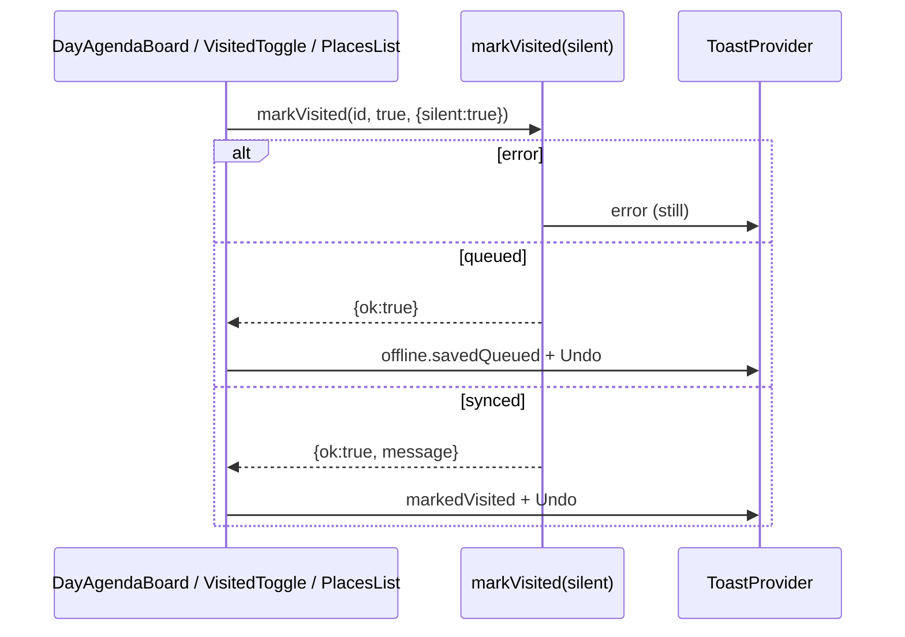

# SDD: Silent markVisited toast (no double toast)

- **Repo:** `japan_trip_app`
- **Status:** `implemented`
- **Date:** 2026-10-28
- **Related:** [docs/architecture.md](../architecture.md), [004-offline-mode](004-offline-mode.md), [007-map-feedback-a11y](007-map-feedback-a11y.md), [010-swipe-haptics-push-phrases](010-swipe-haptics-push-phrases.md)

## 1. Context / current architecture

`useOutbox().markVisited` (`outbox-provider.tsx`) always calls `applyEnqueueToast` after `runToggleVisited`, which toasts the success message or `offline.savedQueued`.

Callers that also show their own Undo toast after awaiting `markVisited`:

- `day-agenda-board.tsx` — swipe right / “…” sheet `setVisited`
- `visited-toggle.tsx` — place detail toggle
- `places-list.tsx` — places “…” sheet

Result: two toasts for one action (e.g. “已标记访问” then “已标记访问 · 撤销”).

`submitSpend` already supports `{ silent?: boolean }` so the quick-expense sheet can own a single Undo toast.

## 2. Problem and non-goals

**Problem:** Marking a stop visited shows two toasts; the Undo action should appear on exactly one toast.

**Non-goals:**

- No changes to prep toggle, spend, swipe UX, map, or toast provider API
- No new i18n keys (reuse `action.markedVisited` / `action.markedUnvisited` / `offline.savedQueued` / `common.undo`)
- No SDD wait — owner-approved TASK RUN 6 (2026-10-27)

## 3. Questions asked and answers

| Question | Answer |
| --- | --- |
| Scope beyond DayAgendaBoard? | Yes — apply the same pattern only where callers also toast (visited-toggle, places-list) |
| Offline/queued toast text? | Single toast uses `offline.savedQueued` and keeps Undo |
| Owner approval? | Alex, 2026-10-27 23:44 MYT — implement immediately |

## 4. Proposed approach, pros / cons, rejected alternatives

**Approach:** Add optional `{ silent?: boolean }` to `markVisited`. When `silent`, skip success/queued toasts; still toast errors. Callers that own an Undo toast pass `{ silent: true }` on the forward call and Undo, check `result.ok`, and pick message: queued (`!result.message`) → `offline.savedQueued`, else marked visited/unvisited.

**Pros:**

- Matches existing `submitSpend` silent pattern
- One toast with Undo online and offline
- Errors still surface from outbox

**Cons / risks:**

- Undo with `silent` has no outbox toast (optimistic flip is the feedback) — accepted per task

**Rejected alternatives:**

| Alternative | Why not |
| --- | --- |
| Remove caller Undo toast | Loses Undo affordance |
| Remove outbox toast only in DayAgendaBoard via special-case | Duplicates logic; visited-toggle / places-list would still double |

**Picture:**

UI — one toast after mark visited (swipe or sheet):

```text
+----------------------------------+
| Schedule day                     |
|  [swipe →] Stop A                |
+----------------------------------+
|  toast: 已标记访问 · 撤销        |  ← exactly one
+----------------------------------+
Offline: 已离线保存，联网后同步 · 撤销
```

Function:



## 5. Acceptance criteria and verification

- [x] `markVisited` accepts optional `{ silent?: boolean }`; silent suppresses success/queued toast; errors still toast
- [x] DayAgendaBoard `setVisited` + Undo pass silent; one Undo toast; queued uses `offline.savedQueued`
- [x] visited-toggle + places-list same pattern (they also own Undo toasts)
- [x] `npx tsc --noEmit`, `npm run lint`, `npm test`, `npx next build` all pass

## 6. Status history

| Date | Status | Note |
| --- | --- | --- |
| 2026-10-28 | approved | Owner TASK RUN 6 — implement same run |
| 2026-10-28 | implemented | silent option + three callers |
