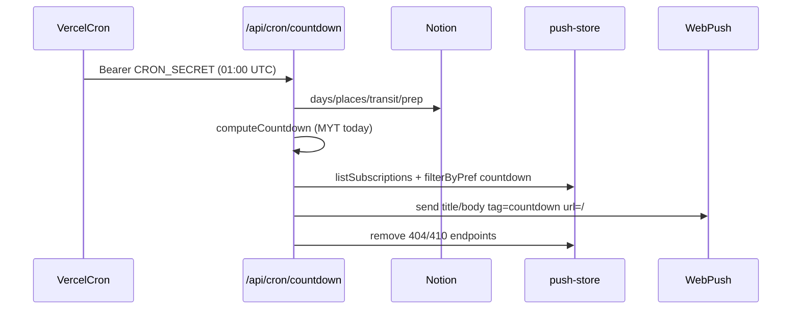

# SDD: Daily countdown push

- **Repo:** `o000o_active/japan_trip_app`
- **Status:** `implemented`
- **Date:** 2026-10-28
- **Related:** [architecture](../architecture.md), [010 Web Push](010-swipe-haptics-push-phrases.md), README Push reminders setup

## 1. Context / current architecture

Web Push is live (SDD 010): `src/lib/push.ts`, `src/lib/push-store.ts` (Upstash REST + `PUSH_SUBSCRIPTIONS` fallback), `src/lib/reminders.ts`, `/api/push/subscribe`, `/api/push/test`, `/api/cron/reminders` (11:00 UTC = 20:00 JST evening-before), Settings `push-reminders-card.tsx`, Serwist SW `push` + `notificationclick` (`data.url`, `tag`). Production already has a real subscription in Upstash **without** prefs — must stay working (missing prefs = everything on).

## 2. Problem and non-goals

**Problem:** Alex wants a morning countdown: every day at ~09:00 MYT, tell how many days are left until the trip (and useful day-of / during-trip copy).

**Non-goals:**

- Redesign `/map` or other pages; Notion schema / submodule / scripts.
- Git writes, deploy, `.env*` edits.
- Per-user accounts; native APNs; changing the evening reminders schedule.
- Killing/restarting Alex’s `next dev` on :3000.

## 3. Questions asked and answers

| Question | Answer |
| --- | --- |
| Owner approval to skip draft wait? | Yes — Alex (2026-10-27 23:44 MYT) approved this scope; implement in the same run. |
| Cron time? | 09:00 MYT → `0 1 * * *` (01:00 UTC). Hobby: once/day, hour precision (may fire 01:00–01:59 UTC = 09:00–09:59 MYT). |

## 4. Proposed approach, pros / cons, rejected alternatives

**Approach:**

1. Pure `src/lib/countdown.ts` `computeCountdown` — calendar “today” in `Asia/Kuala_Lumpur` (Intl `en-CA`), trip start/end = min/max Day dates, UTC-noon day diff. Locale zh/en. Stable id `countdown:<today>`, `url: "/"`, `tag: "countdown"`.
2. Per-subscription `prefs: { reminders, countdown }` on the push store (defaults true; `filterByPref`; `updatePrefs` / `getPrefs`; re-subscribe keeps prefs).
3. `/api/push/prefs` GET/PATCH (editor session). Cron auth helper `src/lib/cron-auth.ts`. New `/api/cron/countdown`; reminders cron filters `prefs.reminders !== false`.
4. `vercel.json` add countdown cron. Settings switches. README + this SDD.

**Pros:** Reuses live Web Push path; backward compatible; pure logic is unit-tested; click opens Overview.

**Cons / risks:** Hobby cron may land anywhere in the 09:00–09:59 MYT hour. Env-fallback store cannot PATCH prefs (UI disabled + hint).

**Rejected alternatives:**

| Alternative | Why not |
| --- | --- |
| Fold into evening reminders cron | Different time zone intent (morning MYT vs evening JST); separate message. |
| Notion property for prefs | Forbidden schema change; prefs belong with the subscription. |

**Picture:**

UI — Settings prefs (when subscribed)

```text
+--------------------------------------+
| 行前提醒 / Trip reminders            |
| Status: Reminders on                 |
| 行前提醒     [====o]  (switch)       |
| 每日倒数     [====o]  (switch)       |
| [关闭] [发送测试] [复制订阅 JSON]     |
+--------------------------------------+
User: toggles 每日倒数 → optimistic PATCH /api/push/prefs
```

Function — morning countdown



### Sample messages (zh, trip start 2026-10-25 … end 2026-11-01)

| MYT today | Title | Body (example) |
| --- | --- | --- |
| 2026-10-17 (N=8) | 还有 8 天出发去日本 🇯🇵 | 出发日 10月25日 周日 |
| 2026-10-18 (N=7) + prep | 还有 7 天出发去日本 🇯🇵 | Prep 还有 2 项未完成：签证、换日元 |
| 2026-10-24 (N=1) | 明天出发去日本 🇯🇵 | (prep rule or departure date line) |
| 2026-10-25 | 今天出发！🇯🇵 | 08:00 MH88 KUL→HND |
| 2026-10-27 (day 3) | 日本第 3 天 · 东京 | 第一站 09:00 Senso-ji |
| 2026-11-01 | 日本第 8 天 · 大阪 · 最后一天 | 第一站 … / Day title |
| 2026-11-02 | _(null — stop)_ | |

en locale uses equivalent English titles/bodies. Timezone edge: `2026-10-24T15:59Z` → MYT 23:59 still N-day; `16:00Z` → MYT 00:00 next calendar day.

### Vercel Hobby cron note (checked 2026-10-28)

Up to 100 cron jobs/project; each at most once per day; hour precision. Schedule `0 1 * * *` may fire any time **01:00–01:59 UTC** (= **09:00–09:59 MYT** / 10:00–10:59 JST).

## 5. Acceptance criteria and verification

- [x] `computeCountdown` + thorough `countdown.test.ts` (TZ edges, N=8/7+prep, N=1, departure, mid-trip, last day, after end, no days, unsorted)
- [x] Prefs on push-store + tests (defaults, merge, filter, backward compat)
- [x] `/api/push/prefs`, `/api/cron/countdown`, reminders filter, `cron-auth.ts`, `vercel.json`
- [x] Settings switches (zh+en, a11y 44px / role=switch), README + SDD
- [x] Release notes: `scripts/release-notes.sh` + bump-version workflow (no `--generate-notes`)
- [x] `npx tsc --noEmit`, `npm run lint`, `npm test`, `npx next build`
- [x] Tiny fix (Alex 2026-10-28): `departureTransitBody` does not re-append `from→to` when the transit name already contains that route (normalized: ignore spaces, treat `->` / `→` alike). Tests: name `"MH88 KUL→HND"` → body `"08:00 MH88 KUL→HND"`; name `"Nozomi to Kyoto"` + Tokyo→Kyoto → `"10:00 Nozomi to Kyoto Tokyo→Kyoto"`. `firstStopBody` unchanged (name OR route, never both).

## 5b. Extra — release notes for direct-to-main (Alex 01:07)

`gh release create --generate-notes` was empty because commits land on `main` without PRs. Workflow now:

1. `npm version patch` → tag `VERSION`
2. `PREV="$(git describe --tags --abbrev=0 "${VERSION}^" 2>/dev/null || true)"`
3. `bash scripts/release-notes.sh "${VERSION}" "${PREV}" > notes.md`
4. `gh release create "${VERSION}" --title "${VERSION}" --notes-file notes.md`

Script groups conventional `feat` / `fix` / other, skips `[skip version]`, lists merge commits under 合并的 PR, appends Full Changelog compare URL when `PREV` exists. Local smoke: `bash scripts/release-notes.sh v0.1.12`.

## 6. Status history

| Date | Status | Note |
| --- | --- | --- |
| 2026-10-28 | draft | Owner-approved same-run implement |
| 2026-10-28 | approved | Alex owner approval 2026-10-27 23:44 MYT |
| 2026-10-28 | implemented | Countdown module, prefs, cron, Settings UI, release-notes.sh |
| 2026-10-28 | implemented | Tiny fix: skip duplicate route in departureTransitBody when name already has it |
