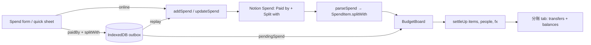
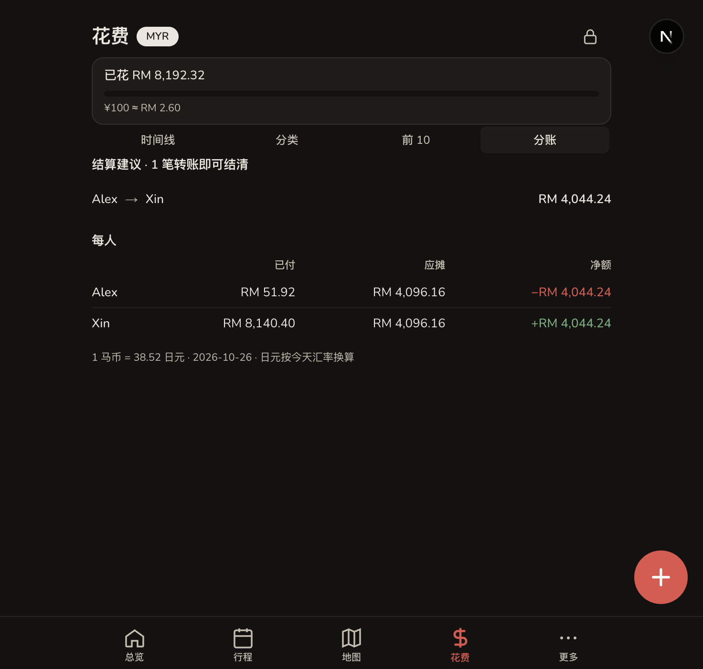

# SDD: Settle-up tab + per-expense "Split with"

- **Repo:** `o000o_active/japan_trip_app`
- **Status:** `implemented`
- **Date:** 2026-11-04
- **Related:** [architecture](../architecture.md), [004 offline outbox](004-offline-mode.md), [006 quick expense](006-quick-expense-forms.md), [todo backlog「分账结算」](../todo.md)

## 1. Context / current architecture

- Spend rows live in the Notion Spend DS. `src/lib/trip.ts` `parseSpend` reads `Paid by` (select) into `SpendItem.paidBy`. Nothing aggregates it.
- Writers: `addSpend` / `updateSpend` in `src/app/actions.ts` (lines ~530–620) set `Paid by`. Offline: `src/lib/offline-actions.ts` + `src/lib/outbox-core.ts` carry `paidBy` in the outbox payload.
- Forms: `src/components/spend-form.tsx` (`PaidByField`, chips from `people`) and `src/components/quick-expense-sheet.tsx`. `people` = Editors DB names via `getEditorNames()`.
- `/budget` = `src/app/budget/layout.tsx` → `BudgetBoard` with tabs `timeline | category | top` (`src/components/budget-board.tsx`). Board merges outbox `pendingSpend` into actuals. Amounts convert with live FX `getMyrToJpy()` (`src/lib/exchange.ts`).
- Schema source: `notion/src/main.ts` (Spend ~L197–250) and `notion/scripts/migrate-v2.mjs` (`patchDataSource(spendId, …)` ~L163).

## 2. Problem and non-goals

**Problem:** The group records who paid but cannot see who owes whom. Some costs are shared by only part of the group, such as one person's shopping or a two-person taxi, so splitting every expense equally across all editors is wrong.

**Non-goals:**

- Recording that a transfer was paid ("mark settled"). The view shows current balances only.
- Per-person custom amounts or percentages. Every split is equal among the selected people.
- Historical FX per expense. Yen items convert at today's rate (see risks).
- Splitting `Estimate` rows.

## 3. Questions asked and answers

| Question | Answer |
| --- | --- |
| Split rule? | Add a Notion `Split with` multi-select per expense; empty means everyone (Alex 2026-11-04). |
| Trip phase? | Before departure, so this ships ahead of the trip. |

## 4. Proposed approach, pros / cons, rejected alternatives

**Approach:**

1. **Schema:** add `Split with: { multi_select: { options: [] } }` to Spend in `notion/src/main.ts` and in the `patchDataSource(spendId, …)` block of `migrate-v2.mjs`. This is idempotent, so re-running `npm run migrate:v2` adds the column. Options are created on first write, the same as `Paid by` today.
2. **Read:** `multiSelectOf(page, name)` in `src/lib/notion.ts`; `SpendItem.splitWith: string[]` in `src/lib/types.ts`; `parseSpend` fills it.
3. **Write:** `addSpend` / `updateSpend` read `splitWith` (repeated form field) and write `Split with`. If every current person is selected, write an empty list (= everyone, so later editors are included automatically).
4. **Offline:** outbox spend payload gains optional `splitWith?: string[]`. Older queued entries without it mean everyone. `offline-actions.ts` maps it both ways.
5. **Forms:** new `SplitWithField` (multi-chip, "全员" shortcut) under `PaidByField` in `spend-form.tsx` and in `quick-expense-sheet.tsx`. Default: everyone selected.
6. **Math (pure, tested):** `settleUp(items, people, jpyPerRm)` in `src/lib/spend.ts`:
   - Only `kind === "Actual"` rows with a `paidBy`; rows missing the payer are counted in `unassigned`.
   - Participants = `splitWith` if non-empty, else `people`. Payer +amount, each participant −amount/n (RM).
   - Greedy match of the largest debtor with the largest creditor gives at most n−1 transfers. Cents are rounded; balances within RM 0.01 count as settled.
   - Returns `{ balances: {name, paid, share, net}[], transfers: {from, to, rm}[], unassigned: SpendItem[] }`.
7. **UI:** 4th tab `分账 / Split` in `BudgetBoard`, using merged actuals (Notion + pending outbox). Follows the RM/¥ toggle. Compact rows (`src/components/compact/*`). The unassigned row expands (`<details>`) to list those items, which link to their edit page. Read-only for viewers.
8. i18n zh + en for every new string.

**Pros:** Uses data the group already enters; one new Notion column; works offline because it's computed client-side from merged actuals; pure function is unit-testable.

**Cons / risks:**

- Yen items are converted at today's FX, so the RM transfer amounts drift slightly day to day. The tab shows the rate and date.
- Past expenses have an empty `Split with`, so they count as everyone, which is today's implied behavior.
- A name in `Paid by` / `Split with` that is no longer in Editors still shows in balances (by design, so money never disappears).
- Requires running `npm run migrate:v2` once against the live Notion before deploy. If the column is missing, `updateSpend` writes would fail, so the write must skip `Split with` when the property is absent (check once via cached data-source schema, or catch the validation error and retry without it).

**Rejected alternatives:**

| Alternative | Why not |
| --- | --- |
| Equal split across all editors, no schema change | Alex chose per-expense participants; equal-all is wrong for personal shopping |
| Separate `/budget/settle` route | Extra route needs its own offline caching; a tab reuses the cached `/budget` shell |
| Store settlement transfers in Notion | Out of scope; balances are derivable |

**Picture:**

UI — Expenses, new tab, plus the expense form field.

```text
+---------------------------------------+
| 支出                       [RM | ¥]    |
| 已花 RM 4,210 / 预算 RM 6,000  ▓▓▓▓░   |
| [时间线] [类别] [最高] [分账]  ← new    |
+---------------------------------------+
| 结算建议 · 2 笔转账即可结清             |
| Ben   →  Alex      RM 312.40          |
| Cara  →  Alex      RM  88.10          |
|---------------------------------------|
| 每人         已付      应摊      净额   |
| Alex      1,820.00  1,419.50  +400.50 |
| Ben         950.00  1,262.40  −312.40 |
| Cara        600.00    688.10   −88.10 |
|---------------------------------------|
| ⚠ 2 笔未填付款人，未计入            ›  |
| 汇率 1 RM = ¥39.30 · 2026-11-04        |
+---------------------------------------+

Expense form / quick sheet:
| 付款人   (Alex) ( Ben ) ( Cara )       |
| 分摊人   [✓Alex] [✓Ben] [ Cara ] 全员  |
User: unticks Cara → saves → 分账 tab recomputes
```

Function:



## 5. Acceptance criteria and verification

- [x] `npm run migrate:v2` adds `Split with` to the live Spend DS; re-running is a no-op. Ran 2026-11-04: "Added Split with to 05e7b3dc…"; the script only patches missing columns (`missingProps`).
- [ ] New expense with Cara unticked → Notion row has `Split with` = Alex, Ben; all ticked → empty. **Not browser-verified:** adding needs the editor PIN. Covered by `normalizeSplitWith` tests + form/outbox mapping; spot-check on device.
- [ ] Editing an existing expense pre-fills the chips (empty = all ticked). Same PIN limit; spot-check on device.
- [ ] Offline add with partial split replays with the same `Split with`. Payload carries `splitWith`; `formDataFromSpendPayload` appends it. Not device-checked.
- [x] `settleUp` unit tests: equal split, partial split, payer not a participant, unassigned payer, Yen conversion, cent rounding, ≤ n−1 transfers, removed-editor name, no Editors list (`src/lib/spend.test.ts`).
- [x] 分账 tab matches a hand-computed example on live data: total RM 8,192.32 between Alex and Xin → RM 4,096.16 each; Alex paid RM 51.92 → "Alex → Xin RM 4,044.24". Dark mode, zh strings checked; en strings added.
- [x] `npm run lint`, `npm run typecheck`, `npm test` pass (25 files, 195 tests).
- [x] Browser: `next dev` on live Notion (prod build not run; SW not involved in this change).



**Deviation:** tapping the "no payer" row expands those expenses inline instead of filtering the timeline (no second filter mode needed). If `Split with` is missing in Notion, writes retry without it (`withSplitWithFallback` in `actions.ts`).

## 6. Status history

| Date | Status | Note |
| --- | --- | --- |
| 2026-11-04 | draft | From enhancement review; Alex picked per-expense Split with |
| 2026-11-04 | approved | Alex: "approve 016–017" |
| 2026-11-04 | implemented | Split tab + Split with field; live migrate run; form writes await device check with PIN |
