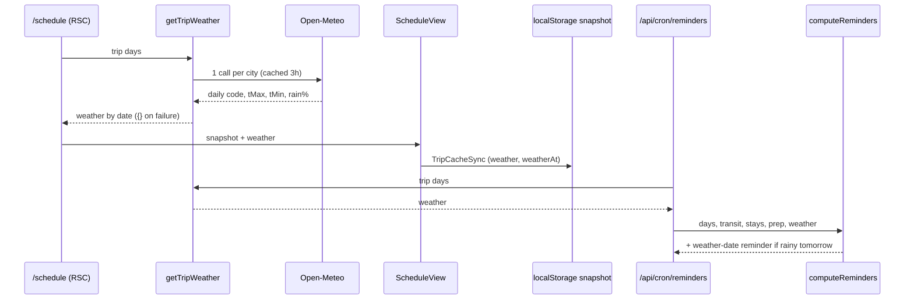
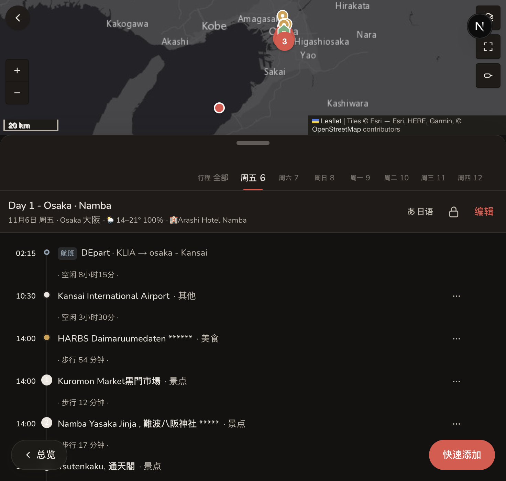

# SDD: Daily weather on Schedule + rain hint in evening push

- **Repo:** `o000o_active/japan_trip_app`
- **Status:** `implemented`
- **Date:** 2026-11-04
- **Related:** [architecture](../architecture.md), [010 push](010-swipe-haptics-push-phrases.md), [004 offline snapshot](004-offline-mode.md), [todo backlog「天气」](../todo.md)

## 1. Context / current architecture

- Schedule: `src/app/schedule/page.tsx` → `loadTripSnapshot()` → `ScheduleView` (`src/components/schedule-view.tsx`). The sticky day header (~L480–525) shows `date · city 漢字 · 🏨 stay · pending ›`.
- Day city comes from `TripDay.city` (`Tokyo | Kyoto | Osaka | Other`); `CITY_COORDS` in `src/lib/types.ts` has coords for the first three.
- External API pattern: `src/lib/exchange.ts` uses `fetch` with `next.revalidate`, a fallback chain, and never throws.
- Offline: `TripCacheSync` writes `TripSnapshot` v2 (`src/lib/trip-cache.ts`) to localStorage; `ScheduleOfflineFallback` renders from it.
- Evening push: `/api/cron/reminders` (11:00 UTC = 20:00 JST) → pure `computeReminders(data, now, opts)` in `src/lib/reminders.ts` → `web-push`.

## 2. Problem and non-goals

**Problem:** On the trip you plan the next day the evening before (umbrella, indoor vs outdoor stops). Today the app has no weather, so you leave it to check another app.

**Non-goals:**

- Hourly forecast, radar, or weather alerts.
- Weather for dates more than 16 days out (Open-Meteo forecast horizon) or past days (no history call).
- Weather for `Other`-city days in v1 (no fixed coords; see todo).
- Changing push schedule or prefs. The rain hint rides on the existing evening `reminders` pref.

## 3. Questions asked and answers

| Question | Answer |
| --- | --- |
| Show where? | Schedule day header, plus a rain line in the evening push (Alex 2026-11-04). |
| Trip phase? | Before departure; forecast appears once trip days are within 16 days. |

## 4. Proposed approach, pros / cons, rejected alternatives

**Approach:**

1. **`src/lib/weather.ts`**
   - Pure: `weatherGlyph(wmoCode)` → emoji + i18n key (clear / cloudy / fog / rain / snow / storm); `isRainy(w)` = `rainPct >= 50`; `forecastWindow(days, today)` → per-city `{start, end}` limited to `[today, today+15]`.
   - IO: `getTripWeather(days)` → one Open-Meteo `/v1/forecast` call per city in window (`daily=weather_code,temperature_2m_max,temperature_2m_min,precipitation_probability_max&timezone=Asia/Tokyo`), `next: { revalidate: 10800 }`, `AbortSignal.timeout(3000)`. Returns `Record<dateKey, DayWeather>` (`{ code, tMax, tMin, rainPct }`), matched by day date + city. Any failure → `{}`. Never throws.
2. **Schedule:** `schedule/page.tsx` fetches weather in parallel with the snapshot and passes `weather` to `ScheduleView`. Header meta gets `· ☔ 12–17° 80%` after the city (rain % only when ≥ 20). `aria-label` spells it out ("小雨，12 到 17 度，降雨概率 80%").
3. **Offline:** optional `weather?: Record<string, DayWeather>` and `weatherAt?: string` on `TripSnapshot` v2. No version bump, since old readers ignore the field. `TripCacheSync` on Schedule writes it; `ScheduleOfflineFallback` shows it.
4. **Push:** `/api/cron/reminders` also calls `getTripWeather`. `computeReminders` takes optional `data.weather`; if tomorrow is a trip day and `isRainy`, add one reminder `tag: weather-<date>`: 「明天京都 ☔ 降雨 80% · 12–17°，记得带伞」 / "Tomorrow Kyoto ☔ 80% rain · 12–17°, bring an umbrella". Reflected in `?dry=1` output. Sent only to subs with `reminders` pref on.
5. i18n zh + en; unit tests for glyph mapping, window clipping, rainy threshold, reminder text + tag + skip when weather missing.

**Pros:** Free, keyless API; no new deps; never blocks the page; pure planners stay testable; one push per rainy evening at most.

**Cons / risks:**

- Open-Meteo free tier is for non-commercial use (≤10k calls/day). Usage is about 3 cities × 8 refreshes per day.
- City-centre coords: a Nara or Uji day labelled Kyoto gets Kyoto weather.
- Forecast cached up to 3 h server-side and longer offline. The header shows the forecast time in the `title` / offline banner.
- Adds one more external dependency to the reminders cron. On failure it silently skips the weather line, and the other reminders still send.

**Rejected alternatives:**

| Alternative | Why not |
| --- | --- |
| OpenWeatherMap / JMA | Needs an API key, or has no stable JSON forecast API |
| Fetch in the browser | Adds client network calls and a CSP/offline story; server fetch is cached and shared |
| Weather icon on every day tab | Tabs are 52px wide; header line is enough for v1 |
| Separate weather cron | Extra cron for one line; the evening reminder already runs at the right time |

**Picture:**

UI — Schedule sticky header (new segment marked).

```text
+------------------------------------------------+
|  周日 26  周一 27  [周二 28]  周三 29  周四 30    |
+------------------------------------------------+
| Day 4 · Arashiyama                         ...  |
| 10/28 · Kyoto 京都 · ☔ 12–17° 80% · 🏨 Hotel…   |
|                    ^^^^^^^^^^^^^^^^ new         |
+------------------------------------------------+
| 08:30  Bamboo grove                             |
| 10:00  Tenryu-ji                                |
+------------------------------------------------+

Evening push (20:00 JST, day before):
  明天京都 ☔ 降雨 80% · 12–17°，记得带伞
User: taps push → opens /schedule?day=<tomorrow>
```

Function:



## 5. Acceptance criteria and verification

- [x] Days within 16 days show glyph + temps (+ rain % ≥ 20) in the header. Live 2026-11-04: Day 1 Osaka "🌦 14–21° 100%"; all 7 trip days (Nov 6–12) got a forecast.
- [x] API down / timeout → `{}`, schedule renders without weather (`getTripWeather` catches; `parseOpenMeteo` returns `{}` for error payloads, unit-tested). Not forced in browser.
- [ ] Offline (airplane mode) → header still shows cached weather. Snapshot verified: localStorage `weather` has all 7 days + `weatherAt`, and `ScheduleOfflineFallback` passes it through. Airplane mode not device-checked.
- [x] Dry-run `/api/cron/reminders?dry=1&now=2026-11-05T11:00:00Z` lists `weather:2026-11-06` 「明天大阪可能下雨 · 🌦️ 降雨 100% · 14–21°，记得带伞」; `now=2026-11-06T11:00:00Z` (Nov 7 at 0 %) lists none.
- [x] Unit tests for `weather.ts`, rain reminders, `carryWeather`; lint, typecheck, test pass (25 files, 195 tests).
- [x] Browser (dark, zh) at 1024 wide on `next dev`; en strings added. Light mode not screenshotted.



**Deviation (data):** live Notion `City` on Days is a **multi-select** (travel days list two cities), while the app read it as select, so every `TripDay.city` was null. `parseDay` now reads select, else the first multi-select value. This also brings back the city + kanji in the Schedule header. Follow-up fix (Alex: "修"): `addDay` / `updateDay` now read the column type and write select or multi-select (`src/lib/day-city.ts`); editing keeps a two-city list when the chosen city is already in it. Verified on live Day 4: [Kyoto, Osaka] written back unchanged.

**Implementation note:** only Schedule fetches weather; `writeTripCache` keeps the cached `weather` when another page writes a snapshot without it (`carryWeather`).

## 6. Status history

| Date | Status | Note |
| --- | --- | --- |
| 2026-11-04 | draft | From enhancement review; Alex picked UI + evening push |
| 2026-11-04 | approved | Alex: "approve 016–017" |
| 2026-11-04 | implemented | Header + offline snapshot + rain push; City read accepts multi-select |
