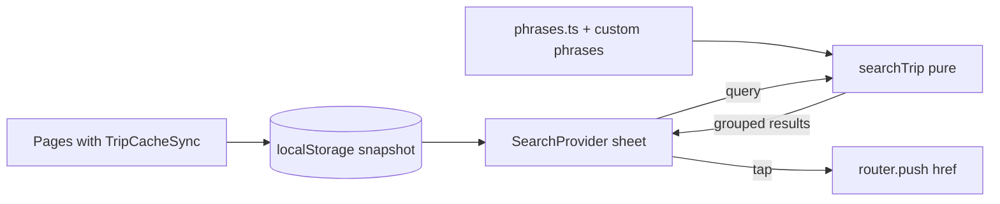

# SDD: Global search (offline-capable)

- **Repo:** `o000o_active/japan_trip_app`
- **Status:** `draft`
- **Date:** 2026-11-04
- **Related:** [architecture](../architecture.md), [004 offline snapshot](004-offline-mode.md), [015 offline navigation](015-offline-navigation.md), [todo backlog「全局搜索」](../todo.md)

## 1. Context / current architecture

- Data is spread across `/places`, `/stays`, `/transit`, `/budget`, `/phrases`, and the per-day Schedule. Each route has its own list; there is no cross-entity lookup.
- Every Notion-backed page mounts `TripCacheSync`, which writes the full itinerary (`days, places, transit, stays, spend, prep`) to localStorage (`src/lib/trip-cache.ts`, `readTripCache()` memoized for `useSyncExternalStore`).
- Phrase deck is bundled in `src/lib/phrases.ts`; custom phrases live in localStorage.
- Global sheets already follow a provider pattern mounted in the root layout: `QuickExpenseProvider` (`openQuickExpense`), `UnlockProvider`.
- Headers: Overview uses `PageHeader` (`src/components/compact/page-header.tsx`, `action` slot). Schedule has its own sticky header in `schedule-view.tsx`.

## 2. Problem and non-goals

**Problem:** On the go you need "what was that ramen place's address", "which day is teamLab", "hotel confirmation number", or "how do I say no shellfish" quickly. Today that means guessing which tab holds it, and it fails offline on routes you haven't opened.

**Non-goals:**

- Server-side or Notion full-text search. This is client-only over the snapshot.
- Fuzzy or romaji↔kana matching. v1 is normalized substring matching.
- Searching Notion page bodies or long notes beyond the `Notes` property.
- Search history or recents.

## 3. Questions asked and answers

| Question | Answer |
| --- | --- |
| Which items? | Global search was picked from the backlog (Alex 2026-11-04); no further scope questions. Defaults below are the agent's and can change before approval. |
| Trip phase? | Before departure. |

## 4. Proposed approach, pros / cons, rejected alternatives

**Approach:**

1. **Pure `src/lib/search.ts`:** `searchTrip(snapshot, phrases, query, locale)`.
   - Normalize: NFKC (full-width → half-width), lowercase, collapse spaces. Empty or 1-char Latin query → no results (1 CJK char is allowed).
   - Fields: days (name, city + kanji), places (name, type, notes), stays (name, address, confirmation), transit (name, from, to, mode), spend (name, category, notes, paid by), prep (name), phrases (zh/en/ja/romaji).
   - Score: name prefix 3 > name contains 2 > other field 1. Group by kind in fixed order, max 8 per group, 40 total.
   - Each result carries `{ kind, id, title, meta, href }`.
2. **Hrefs:** day → `/schedule?day=<id>`; place with a day → `/schedule?day=<dayId>`, else `/places`; transit with a day → `/schedule?day=<dayId>`, else `/transit`; stay → `/stays`; spend → `/budget/<id>`; prep → `/prep`; phrase → `/phrases`.
3. **`src/components/search-provider.tsx`:** root-layout provider exposing `openSearch()`. Full-height sheet with an autofocused input (`enterkeyhint="search"`), results in compact rows (`CompactRow`) with group headers, highlighted match, Esc / swipe-down to close. It reads the snapshot via `useSyncExternalStore(subscribeTripCache, readTripCache)` plus custom phrases, and debounces queries by 120 ms. Haptic `select` on tap.
4. **Entry points:** 🔍 button in the Overview `PageHeader` action slot and in the Schedule sticky header; `/` keyboard shortcut on desktop.
5. **Empty states:** no snapshot →「先联网打开一次 app 以建立离线索引」; no results →「找不到「{q}」」.
6. i18n zh + en; unit tests for normalization, scoring, grouping/caps, hrefs, CJK single-char.

**Pros:** Works fully offline (data + code already on the device); no server or Notion load; one pure function, easy to test; reuses the provider and compact-row patterns.

**Cons / risks:**

- Results are only as fresh as the last snapshot write. The sheet footer shows the snapshot time.
- Offline taps to a route never visited still land on `/~offline` (SDD 015 behavior). Schedule and budget routes are usually cached.
- Snapshot size is small (one trip), so a linear scan is fine. Revisit if it grows to thousands of rows.
- Hotel confirmation numbers are already readable by any viewer; search does not widen exposure but makes them easier to find (see risks.md "soft security").

**Rejected alternatives:**

| Alternative | Why not |
| --- | --- |
| `/search` route | Needs its own SW cache entry; unvisited → offline fallback. A sheet works everywhere |
| Notion search API | Online-only, rate-limited, slower |
| Fuse.js / MiniSearch | New dep for a few hundred rows; substring is enough for v1 |

**Picture:**

UI — sheet opened from Overview.

```text
Overview                          [🔍] [🔓]
          User taps 🔍
                 ↓
+---------------------------------------+
| 🔍 [ 拉面                       ] 取消 |
+---------------------------------------+
| 地点                                   |
|  一兰 拉面 · Shibuya    10/26 Day 2  › |
|  Menya Inoichi · Kyoto  10/28 Day 4  › |
| 支出                                   |
|  拉面 ¥1,980 · Alex     10/26        › |
| 日语短句                               |
|  这个拉面不要葱 · ネギ抜きで          › |
|---------------------------------------|
| 离线索引 · 更新于 22:41                 |
+---------------------------------------+
User: taps 一兰 → /schedule?day=<Day 2>
```

Function:



## 5. Acceptance criteria and verification

- [ ] 🔍 on Overview and Schedule opens the sheet; `/` opens it on desktop; Esc / swipe-down closes it.
- [ ] Query matches across places, stays (incl. confirmation), transit, spend, prep, days, and phrases; full-width input ("ＴＥＡＭＬＡＢ") matches "teamLab".
- [ ] Tapping a result lands on the right day / list / expense detail.
- [ ] Airplane mode after one online visit → search still returns results.
- [ ] Unit tests for `search.ts`; `npm run lint`, `typecheck`, `test` pass.
- [ ] Browser check at 390×844 light + dark, zh + en; screenshot here.

## 6. Status history

| Date | Status | Note |
| --- | --- | --- |
| 2026-11-04 | draft | From enhancement review; Alex picked global search |
